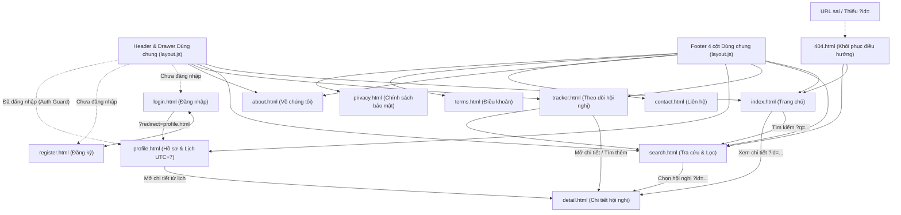

# ConfGuide — Nền tảng Tra cứu, Đánh giá và Theo dõi Hội nghị Khoa học CNTT

> **Slogan:** *Find the Right Place for Your Research*  
> **Môn học:** Internet và Công nghệ Web (IE104)  
> **Đơn vị:** Trường Đại học Công nghệ Thông tin – ĐHQG TP.HCM (UIT)

**ConfGuide** là nền tảng web tĩnh thuần (Vanilla HTML5, CSS3, JavaScript ES6+) hỗ trợ sinh viên, giảng viên và nhà nghiên cứu tra cứu, khuyến nghị, đối chiếu phân hạng học thuật (CORE, Scopus), quy đổi hạn nộp bài theo giờ Việt Nam (`UTC+7` từ chuẩn `AoE / UTC-12`) và theo dõi tiến độ nộp bài các hội nghị khoa học Công nghệ thông tin diễn ra tại Việt Nam (bao gồm cả hội nghị quốc tế được tổ chức tại Việt Nam).

---

## Mục lục

- [1. Giới thiệu](#1-giới-thiệu)
- [2. Thông tin đồ án và nhóm](#2-thông-tin-đồ-án-và-nhóm)
- [3. Liên kết quan trọng](#3-liên-kết-quan-trọng)
- [4. Mô tả bài toán](#4-mô-tả-bài-toán)
- [5. Tính năng chính](#5-tính-năng-chính)
- [6. Sitemap](#6-sitemap)
- [7. Công nghệ và ràng buộc](#7-công-nghệ-và-ràng-buộc)
- [8. Cấu trúc thư mục và quy ước đặt tên](#8-cấu-trúc-thư-mục-và-quy-ước-đặt-tên)
- [9. Quy tắc code](#9-quy-tắc-code)
- [Bản đồ mã nguồn (Source Code Map)](#bản-đồ-mã-nguồn-source-code-map)
- [10. Luồng hoạt động của các chức năng chính](#10-luồng-hoạt-động-của-các-chức-năng-chính)
- [11. Kiểm thử và chất lượng](#11-kiểm-thử-và-chất-lượng)
- [12. Cài đặt và chạy](#12-cài-đặt-và-chạy)
- [13. Công cụ thu thập dữ liệu](#13-công-cụ-thu-thập-dữ-liệu)
- [14. Quy trình làm việc nhóm](#14-quy-trình-làm-việc-nhóm)
- [15. Lời cảm ơn và nguồn dữ liệu](#15-lời-cảm-ơn-và-nguồn-dữ-liệu)
- [16. Định hướng phát triển](#16-định-hướng-phát-triển)
- [Phụ lục A: Bảng ánh xạ tái cấu trúc](#phụ-lục-a-bảng-ánh-xạ-tái-cấu-trúc)
- [Phụ lục B: Số liệu đo ban đầu trước tối ưu](#phụ-lục-b-số-liệu-đo-ban-đầu-trước-tối-ưu)
- [Phụ lục C: Báo cáo tối ưu mã nguồn chi tiết](#phụ-lục-c-báo-cáo-tối-ưu-mã-nguồn-chi-tiết)
- [Phụ lục D: Chẩn đoán và sửa lỗi hiệu ứng chuyển trang](#phụ-lục-d-chẩn-đoán-và-sửa-lỗi-hiệu-ứng-chuyển-trang)
- [Phụ lục E: Báo cáo Clean Code và Tái cấu trúc mã nguồn](#phụ-lục-e-báo-cáo-clean-code-và-tái-cấu-trúc-mã-nguồn)

---

## 1. Giới thiệu

**ConfGuide** (tên thương hiệu hiển thị trên giao diện `ConfGuide`, tên repository `confeguide`) được xây dựng dưới dạng ứng dụng web phía client, không phụ thuộc backend hay framework ngoài. Hệ thống tập trung quy tụ dữ liệu của **30** kỳ hội nghị khoa học CNTT (`data/conference_data.json`) kèm **20** tài khoản mẫu (`data/users.json`) phục vụ thử nghiệm toàn bộ quy trình tra cứu, so sánh, theo dõi hạn nộp và quản lý lịch cá nhân ngay trên trình duyệt.

---

## 2. Thông tin đồ án và nhóm

- **Đề tài:** Xây dựng website tra cứu hội nghị khoa học Công nghệ thông tin tại Việt Nam (ConfGuide)
- **Môn học:** IE104 – Internet và Công nghệ Web
- **Đơn vị đào tạo:** Trường Đại học Công nghệ Thông tin – ĐHQG TP.HCM (UIT)
- **Giảng viên hướng dẫn / Cố vấn chuyên môn:** ThS. Võ Tấn Khoa (Khoa Khoa học và Kỹ thuật Thông tin)
- **Số thứ tự nhóm:** `[CẦN ĐIỀN: Số thứ tự nhóm]`

| STT | Họ và tên | MSSV | Vai trò | % Đóng góp |
|---:|---|---|---|---:|
| 1 | Nguyễn Tài | `24521549` | `[CẦN ĐIỀN: Vai trò cụ thể]` | `[CẦN ĐIỀN: %]` |
| 2 | Lê Hữu Thắng | `24521602` | `[CẦN ĐIỀN: Vai trò cụ thể]` | `[CẦN ĐIỀN: %]` |
| 3 | Dương Nhất Tâm | `24521566` | `[CẦN ĐIỀN: Vai trò cụ thể]` | `[CẦN ĐIỀN: %]` |
| 4 | Nguyễn Chí Nhân | `24521232` | `[CẦN ĐIỀN: Vai trò cụ thể]` | `[CẦN ĐIỀN: %]` |
| 5 | Nguyễn Nhã Quân | `24521445` | `[CẦN ĐIỀN: Vai trò cụ thể]` | `[CẦN ĐIỀN: %]` |
| **Tổng** | | | | **`[CẦN ĐIỀN: 100%]`** |

---

## 3. Liên kết quan trọng

| Hạng mục | Liên kết / Trạng thái |
|---|---|
| **GitHub Repository (Public)** | https://github.com/TaiUITK19/confeguide *(cập nhật `[CẦN ĐIỀN: URL công khai]` nếu nhóm chuyển kho lưu trữ)* |
| **Demo trực tuyến (GitHub Pages)** | `[CẦN ĐIỀN: Link GitHub Pages sau khi bật Settings -> Pages]` |
| **Quản lý công việc (Trello / Notion)** | `[CẦN ĐIỀN: Link bảng công việc Trello hoặc Notion]` |
| **Video báo cáo & Demo (YouTube Unlisted)** | `[CẦN ĐIỀN: Link YouTube ở chế độ Không công khai]` |
| **Thiết kế giao diện (Figma)** | `[CẦN ĐIỀN: Link file Figma thiết kế UI]` |
| **Tài liệu khác (Báo cáo / Slide)** | `[CẦN ĐIỀN: Link báo cáo hoặc slide thuyết trình nếu có]` |

---

## 4. Mô tả bài toán

### Bối cảnh & Vấn đề thực tế
Theo nội dung đặc tả tại [`data/about.json`](data/about.json), người nghiên cứu tại Việt Nam thường gặp ba rào cản khi tìm nơi công bố công trình khoa học:
1. **Thông tin phân tán:** Các thông báo Call for Papers (CFP) nằm rải rác trên nhiều website ban tổ chức và diễn đàn khác nhau, gây tốn thời gian tổng hợp và đối chiếu.
2. **Khó đối chiếu phân hạng:** Các thước đo uy tín như CORE Rankings (`A*`, `A`, `B`, `C`) hay Scopus chưa được quy tụ thống nhất theo tiểu ngành CNTT.
3. **Lệch chuẩn múi giờ nộp bài:** Hạn nộp bài thường công bố theo múi giờ Anywhere on Earth (`AoE`, `UTC-12`) hoặc giờ địa phương ban tổ chức, dễ gây nhầm lẫn khi tính sang giờ Việt Nam (`Asia/Ho_Chi_Minh`, `UTC+7`).

### Mục tiêu & Đối tượng sử dụng
- **Mục tiêu:** Cung cấp nền tảng tập trung phục vụ tra cứu và khuyến nghị hội nghị khoa học Công nghệ thông tin diễn ra tại Việt Nam (bao gồm cả hội nghị quốc tế được tổ chức tại Việt Nam), hỗ trợ tìm kiếm nhanh theo từ khóa/chủ đề, lọc đa tiêu chí, đồng bộ bộ lọc qua URL, quy đổi hạn nộp sang `UTC+7` theo thời gian thực, đối chiếu cạnh nhau nhiều hội nghị và lập lịch hạn nộp cá nhân.
- **Đối tượng sử dụng:** Sinh viên, học viên cao học, nghiên cứu sinh, giảng viên và các nhóm nghiên cứu lĩnh vực Công nghệ thông tin.

---

## 5. Tính năng chính

Tất cả các tính năng dưới đây đã được kiểm chứng trực tiếp trong mã nguồn HTML/CSS/JS hiện tại:

- **Trang chủ & Cổng tìm kiếm ([`index.html`](index.html), [`js/pages/index.js`](js/pages/index.js)):**
  - Ô tìm kiếm nhanh chuyển hướng sang `search.html?q=...` kèm hiệu ứng biến hình thanh tìm kiếm (shared-element View Transition).
  - Hero Slider 3 slide (*Khuyến nghị cá nhân hóa theo trạng thái đăng nhập và lĩnh vực nghiên cứu của tài khoản*, *Hội nghị nổi bật*, *Sắp hết hạn UTC+7*) hỗ trợ tự động chạy, tạm dừng khi hover/focus hoặc vừa cập nhật lĩnh vực, điều hướng bằng bàn phím, nút chấm và thao tác vuốt trên màn hình cảm ứng.
  - Ở Slide 1 sau khi đăng nhập: hiển thị nút **Thêm lĩnh vực** (hoặc **Đổi lĩnh vực** khi đã có lĩnh vực) mở bảng biểu chọn lĩnh vực nghiên cứu trực tiếp (`topicsOnly: true`, không hỏi mục đích tìm kiếm) và đồng bộ vào trường `fieldsOfInterest` của tài khoản. Riêng tài khoản vừa đăng ký mới ở lần đăng nhập đầu tiên sẽ được tự động mở bảng cá nhân hóa đầy đủ gồm cả *1. Mục đích tìm kiếm* và *2. Lĩnh vực nghiên cứu bạn quan tâm*.
  - Danh sách hội nghị sắp diễn ra kèm nút Lưu và nút chọn So sánh.
- **Tra cứu nâng cao & Lọc đa chiều ([`search.html`](search.html), [`js/components/search-core.js`](js/components/search-core.js), [`js/pages/search.js`](js/pages/search.js)):**
  - Tìm kiếm tức thì, gợi ý combobox và gợi ý sửa chính tả bằng khoảng cách **Damerau-Levenshtein**.
  - **6 nhóm bộ lọc accordion**: **Phân hạng (`rank`: `A*`, `A`, `B`, `C`, *Chưa xếp hạng*)**, **Thời gian diễn ra (`eventFrom`–`eventTo` trên 1 dòng & *Đang diễn ra*)**, **Hạn nộp bài (`cfp`: tất cả / đang mở / sắp hết hạn `<= 14 ngày` / đã đóng / chưa rõ + khoảng ngày `from`/`to`)**, **Hình thức tổ chức (`mode`: *Trực tiếp*, *Trực tuyến*, *Kết hợp* — mọi tiêu chí đều tích chọn được kể cả khi có 0 kết quả; bản ghi chưa cập nhật hình thức không bị gộp vào *Kết hợp*)**, **Địa điểm diễn ra (`city`: *Tất cả địa điểm*, *Hà Nội*, *TP. Hồ Chí Minh*, *Tỉnh / thành khác*)** và **Lĩnh vực nghiên cứu (`topic`: 3 lĩnh vực nổi bật *Học máy*, *Trí tuệ nhân tạo*, *Dữ liệu lớn* + 1 tiêu chí *Khác* gồm các lĩnh vực còn lại, vẫn giữ tương thích liên kết URL `?topic=<slug>`)**. Giao diện không hiển thị số đếm sau tiêu chí lọc và giữ vùng kết quả gọn nhẹ.
  - Sắp xếp **10** kiểu, phân trang, thanh chip bộ lọc đang bật, ngăn kéo bộ lọc trên di động (`#filtersSidebar`) và đồng bộ 2 chiều với URL Query Parameters.
- **Chi tiết hội nghị ([`detail.html`](detail.html), [`js/pages/detail.js`](js/pages/detail.js)):**
  - Nạp theo `?id=<slug>`, hiển thị tổng quan (**Giới thiệu**), **Thông tin học thuật** gồm **3 nội dung** (`Xếp hạng`, `Lĩnh vực nghiên cứu`, `Xác minh lần cuối`), đồng hồ đếm ngược thời gian thực tới mốc kế tiếp, và timeline toàn bộ các mốc thời hạn từ dữ liệu gốc quy đổi `AoE → UTC+7`.
  - Xuất lịch sang **Google Calendar** hoặc tải tệp **`.ics`** (từng mốc riêng lẻ hoặc toàn bộ các mốc) và danh sách hội nghị liên quan.
- **Theo dõi hội nghị & So sánh cạnh nhau ([`tracker.html`](tracker.html), [`js/pages/tracker.js`](js/pages/tracker.js), [`js/components/compare.js`](js/components/compare.js)):**
  - Quản lý danh sách hội nghị đã lưu gắn theo tài khoản (`confguide_saved_<userId>` hoặc `confguide_saved_guest`), hiển thị hạn nộp gần nhất và số ngày còn lại.
  - Thanh nổi cuối trang chọn tối đa **3** hội nghị qua `SessionStorage` (`confguide_compare_ids`) và mở modal bảng đối chiếu chi tiết cạnh nhau.
- **Hồ sơ cá nhân & Lịch hạn nộp bài ([`profile.html`](profile.html), [`js/pages/profile.js`](js/pages/profile.js), [`js/components/calendar.js`](js/components/calendar.js)):**
  - Bảo vệ bằng Auth Guard ([`js/core/layout.js`](js/core/layout.js)), cho phép cập nhật thông tin học thuật, chọn/chỉnh sửa lĩnh vực nghiên cứu qua bảng biểu dùng chung (`topicsOnly: true`, không hiển thị mục đích), cắt vuông & nén ảnh đại diện `200×200px` JPEG bằng Canvas 2D.
  - Component lịch tháng hiển thị đồng thời hạn nộp bài (`UTC+7`), ngày diễn ra hội nghị đã lưu và mốc Tracker cá nhân, kèm panel chi tiết theo ngày và 5 mốc sắp tới.
- **Xác thực, Các trang thông tin & Báo lỗi 404 ([`login.html`](login.html), [`register.html`](register.html), [`about.html`](about.html), [`contact.html`](contact.html), [`terms.html`](terms.html), [`privacy.html`](privacy.html), [`404.html`](404.html)):**
  - Đăng nhập/đăng ký sử dụng hàm băm SHA-256 (Web Crypto API), 20 tài khoản seed từ [`data/users.json`](data/users.json) (và mảng `SEED_USERS` dự phòng), dùng ảnh nền cục bộ [`images/ben-cang-nha-rong.jpg`](images/ben-cang-nha-rong.jpg), gắn `needsOnboarding: true` cho tài khoản mới đăng ký và hỗ trợ `?redirect=<url>` an toàn chống open-redirect.
  - Trang [`404.html`](404.html) tự động neo `<base>` trên URL nhiều cấp, phân tích ngữ cảnh lỗi đường dẫn hoặc `?id=` sai, gợi ý sửa chính tả bằng **Damerau-Levenshtein** và hiển thị hội nghị thực tế từ JSON.
  - Trang Giới thiệu đọc nội dung từ [`data/about.json`](data/about.json) kèm modal Đề xuất hội nghị mới (`confguide_proposals`). Header/Footer dùng chung tích hợp modal Cài đặt & Quyền riêng tư, Trợ giúp FAQ, Báo cáo sự cố (`confguide_reports`) và form góp ý chân trang (`confguide_feedback`, debounce `10s`).
- **Hệ thống màu sắc & Chuyển trang ([`css/base/base.css`](css/base/base.css), [`css/base/transition.css`](css/base/transition.css), [`js/core/page-transition.js`](js/core/page-transition.js)):**
  - Hệ Design Tokens **OKLCH** 2 tầng theo tỷ lệ **60:30:10** (kèm fallback `@supports` cho trình duyệt cũ), hiệu ứng kính mờ (`backdrop-filter`) trên thanh điều hướng nổi, Light/Dark Mode đồng bộ qua `confguide_theme` có script chống FOUC ở đầu `<body>`.
  - Chuyển trang mượt không mờ thanh điều hướng nhờ cơ chế 2 nhánh kết hợp Speculation Rules.

---

## 6. Sitemap

Sơ đồ dưới đây phản ánh đúng toàn bộ liên kết điều hướng trong Header (render bởi [`js/core/layout.js`](js/core/layout.js)), Footer và luồng truy cập chi tiết trong mã nguồn:



---

## 7. Công nghệ và ràng buộc

- **Ngôn ngữ & API chuẩn trình duyệt:** HTML5 ngữ nghĩa, CSS3 (CSS Custom Properties, OKLCH, Flexbox, CSS Grid, `@view-transition`), Vanilla JavaScript ES6+ (`Fetch API` + `async/await`, `Web Crypto API` SHA-256, `Web Animations API`, `Speculation Rules`, `LocalStorage`, `SessionStorage`, `Canvas 2D`).
- **Ràng buộc Zero-Library & Zero-Build:** Tuyệt đối không dùng framework hay thư viện UI/animation bên ngoài (không Bootstrap, Tailwind, React, Vue, jQuery, GSAP, Barba.js, Swup); không sử dụng template dựng sẵn; không có công cụ build hay `node_modules` trong sản phẩm chạy.
- **Kiến trúc Client-Side (Không Backend):** Toàn bộ dữ liệu đọc từ 3 tệp JSON tĩnh trong `data/`. Khi trình duyệt chặn CORS dưới giao thức `file:///`, các module tự chuyển sang dữ liệu dự phòng nhúng sẵn (`FALLBACK_CONFERENCES`, `SEED_USERS`, `DEFAULT_UTILS`).

---

## 8. Cấu trúc thư mục và quy ước đặt tên

### Cây thư mục thực tế (47 tệp)

Cấu trúc này khớp 100% với repository hiện tại (`12` trang HTML, `12` tệp CSS, `13` tệp JS, `4` tệp `data/`, `2` hình ảnh trong `images/` và `4` tệp cấu hình/tài liệu ở gốc):

```text
confeguide/
├── index.html                  # Trang chủ & cổng tìm kiếm nhanh
├── search.html                 # Trang tra cứu & lọc hội nghị đa chiều
├── detail.html                 # Trang chi tiết hội nghị (?id=<slug>)
├── tracker.html                # Trang theo dõi danh sách hội nghị đã lưu
├── profile.html                # Trang hồ sơ nghiên cứu & lịch mốc hạn (Auth Guard)
├── about.html                  # Trang giới thiệu đồ án, đội ngũ & đề xuất hội nghị
├── contact.html                # Trang liên hệ & đóng góp thông tin
├── login.html                  # Trang đăng nhập tài khoản
├── register.html               # Trang đăng ký tài khoản mới
├── terms.html                  # Trang điều khoản sử dụng
├── privacy.html                # Trang chính sách bảo mật
├── 404.html                    # Trang báo lỗi 404 & khôi phục đường dẫn
├── css/
│   ├── base/
│   │   ├── base.css            # Design tokens OKLCH 60:30:10, Dark Mode, header, footer, modal, toast
│   │   └── transition.css      # Quy tắc @view-transition, khóa site-nav, WAAPI/keyframes fallback
│   ├── components/
│   │   ├── calendar.css        # Lưới lịch mốc hạn cá nhân (UTC+7) trên profile.html
│   │   └── compare.css         # Thanh nổi dưới đáy và modal bảng so sánh tối đa 3 hội nghị
│   └── pages/
│       ├── 404.css             # Styles riêng cho 404.html
│       ├── about.css           # Styles riêng cho about.html
│       ├── auth.css            # Styles dùng chung cho login.html & register.html
│       ├── detail.css          # Styles riêng cho detail.html
│       ├── index.css           # Styles riêng cho index.html (và @view-transition search-morph)
│       ├── profile.css         # Styles riêng cho profile.html
│       ├── search.css          # Styles riêng cho search.html (và @view-transition search-morph)
│       └── tracker.css         # Styles riêng cho tracker.html
├── js/
│   ├── core/
│   │   ├── layout.js           # Render Header/Footer động, theme, session, auth guard, modal, onboarding & tiện ích
│   │   └── page-transition.js  # Điều phối chuyển trang 2 nhánh (Phương án B) & Speculation Rules
│   ├── components/
│   │   ├── calendar.js         # Logic lịch tháng & tổng hợp mốc hội nghị cá nhân
│   │   ├── compare.js          # Logic so sánh tối đa 3 hội nghị qua SessionStorage
│   │   └── search-core.js      # Lõi chuẩn hóa văn bản, khớp mờ Damerau-Levenshtein, lọc mode/topic & tính điểm
│   └── pages/
│       ├── 404.js              # Logic trang 404.html (gợi ý sửa route & hội nghị liên quan)
│       ├── about.js            # Logic trang about.html & modal đề xuất hội nghị
│       ├── auth.js             # Logic xác thực SHA-256, 20 tài khoản seed & cờ needsOnboarding
│       ├── detail.js           # Logic trang detail.html (timeline, Thông tin học thuật, countdown, .ics)
│       ├── index.js            # Logic trang index.html (Slider 3 slide, chọn lĩnh vực Slide 1 & hội nghị tiêu biểu)
│       ├── profile.js          # Logic trang profile.html (chọn lĩnh vực qua modal bảng, sửa hồ sơ, nén avatar 200x200)
│       ├── search.js           # Logic trang search.html (Proxy state, 6 nhóm lọc, URL sync, chip)
│       └── tracker.js          # Logic trang tracker.html (hiển thị & xóa hội nghị theo user)
├── data/
│   ├── about.json              # Dữ liệu trang Giới thiệu
│   ├── conference_data.json    # Dữ liệu 30 hội nghị khoa học CNTT tại Việt Nam
│   ├── scrape-conferences.py   # Script Python độc lập hỗ trợ cào/trích xuất dữ liệu hội nghị
│   └── users.json              # Dữ liệu 20 tài khoản mẫu
├── images/
│   ├── ben-cang-nha-rong.jpg   # Ảnh nền Bến cảng Nhà Rồng cục bộ cho trang Đăng nhập / Đăng ký
│   └── logo.svg                # Logo SVG dùng chung cho header, footer & favicon
├── .editorconfig               # Đồng bộ UTF-8, LF, indent 2 spaces (4 cho *.py)
├── .gitignore                  # Bỏ qua .env, __pycache__, node_modules, file IDE/OS
├── AGENT.md                    # Quy ước kỹ thuật & hướng dẫn chi tiết cho AI Agents
└── README.md                   # Tài liệu tổng quan & phụ lục kỹ thuật dự án
```

### Quy ước đặt tên & Nguyên tắc tổ chức (rút từ [Phụ lục A](#phụ-lục-a-bảng-ánh-xạ-tái-cấu-trúc))
- **Tên tệp & thư mục:** Chữ thường 100%, `kebab-case`, ASCII không dấu, không khoảng trắng, dùng danh từ tiếng Anh rõ nghĩa (tệp dữ liệu dùng danh từ số nhiều: `users.json`; riêng tệp hội nghị dùng ngoại lệ `conference_data.json` theo xác nhận của chủ dự án).
- **Bộ ba theo trang:** `<trang>.html` ↔ `css/pages/<trang>.css` ↔ `js/pages/<trang>.js` (cặp `login.html` và `register.html` dùng chung `auth.css`/`auth.js`; 3 trang tĩnh `contact.html`, `terms.html`, `privacy.html` dùng `base.css`/`layout.js`, không tạo file rỗng).
- **Phân tầng 3 lớp:** `css/base/` → `css/components/` → `css/pages/` (bảo toàn thứ tự `<link>` cascade) và `js/core/` → `js/components/` → `js/pages/`. Thư mục `images/` gồm 2 tệp đặt phẳng ([`images/logo.svg`](images/logo.svg), [`images/ben-cang-nha-rong.jpg`](images/ben-cang-nha-rong.jpg)).
- **HTML ở gốc & Bất biến `data/`:** 12 trang HTML đặt phẳng tại thư mục gốc để triển khai trực tiếp lên GitHub Pages không cần chỉnh đường dẫn gốc; các tệp dữ liệu `data/` giữ nguyên cấu trúc khóa tương thích với logic JS. Xem lịch sử ánh xạ cũ → mới tại [Phụ lục A](#phụ-lục-a-bảng-ánh-xạ-tái-cấu-trúc).

---

## 9. Quy tắc code

Dự án tuân thủ nghiêm ngặt bộ quy chuẩn kỹ thuật trong [`AGENT.md`](AGENT.md):

- **Phân tách 3 tầng & Zero Inline:** HTML chỉ dựng cấu trúc ngữ nghĩa; không viết `style="..."` hay sự kiện inline (`onclick="..."`, `onchange="..."`); ngoại lệ duy nhất có chủ đích là đoạn `<script>` inline chống FOUC đọc `confguide_theme` ở đầu `<body>` và hai vỏ rỗng `#site-header`, `#site-footer`.
- **Chuẩn HTML5 & CSS3:** Đầu trang chuẩn `<!DOCTYPE html><html lang="vi">`, thẻ/thuộc tính viết thường, đủ `alt` và kích thước cho ``; CSS quản lý tập trung qua Custom Properties trong `:root` và `body.dark`, đặt tên class theo quy ước **BEM** (`block__element--modifier`).
- **Chuẩn JavaScript ES6+:** Chỉ dùng `const`/`let` (cấm `var`), đặt tên biến/hàm `camelCase`, tách biệt hook truy vấn DOM bằng tiền tố `js-` (không dùng class styling BEM để gắn sự kiện), khởi tạo DOM trong `DOMContentLoaded`, bọc `try...catch` ở các thao tác `Storage`/`fetch`, giữ Console sạch `0 errors / 0 warnings`.
- **Tài liệu hóa mã nguồn:** Comment bằng **tiếng Việt** rõ ràng ở đầu tệp, đầu hàm (`@param`, `@returns`) và trước các khối logic quan trọng.

---

## Bản đồ mã nguồn (Source Code Map)

Mọi trang HTML đều dùng chung bộ nền tảng ở `<head>`: `css/base/base.css`, `css/base/transition.css`, `js/core/page-transition.js` và `js/core/layout.js` (`defer blocking="render"`), kèm đoạn script anti-FOUC ngắn đầu `<body>` để áp dụng Dark Mode trước khi vẽ khung hình đầu tiên.

### 1. Nhóm trang HTML (`12` tệp đặt ở thư mục gốc)

| Tệp HTML | Số dòng | Stylesheet đi kèm *(ngoài nền chung)* | Script đi kèm *(ngoài lõi chung)* | Vai trò chức năng chính |
|---|---:|---|---|---|
| [`index.html`](index.html) | 282 | `css/pages/index.css`, `css/components/compare.css` | `js/components/search-core.js`, `js/components/compare.js`, `js/pages/index.js` | Trang chủ: giới thiệu, tìm kiếm nhanh, slider 3 slide, hội nghị tiêu biểu |
| [`search.html`](search.html) | 371 | `css/pages/search.css`, `css/components/compare.css` | `js/components/compare.js`, `js/components/search-core.js`, `js/pages/search.js` | Trang Tra cứu: 6 nhóm lọc accordion, đồng bộ URL, gợi ý chính tả, phân trang |
| [`detail.html`](detail.html) | 333 | `css/pages/detail.css`, `css/components/compare.css` | `js/components/compare.js`, `js/pages/detail.js` | Trang Chi tiết (`?id=`): timeline mốc gốc UTC+7, đếm ngược, Giới thiệu, Thông tin học thuật (3 mục), xuất `.ics` |
| [`tracker.html`](tracker.html) | 87 | `css/pages/tracker.css`, `css/components/compare.css` | `js/components/compare.js`, `js/pages/tracker.js` | Theo dõi hội nghị đã lưu, hiển thị mốc hạn nộp gần nhất & xóa nhanh |
| [`profile.html`](profile.html) | 290 | `css/pages/profile.css`, `css/components/compare.css`, `css/components/calendar.css` | `js/components/compare.js`, `js/components/calendar.js`, `js/pages/profile.js` | Hồ sơ cá nhân (Auth Guard): chỉnh sửa hồ sơ/lĩnh vực/avatar, lịch mốc cá nhân |
| [`about.html`](about.html) | 200 | `css/pages/about.css` | `js/pages/about.js` | Giới thiệu đồ án, minh bạch dữ liệu, đội ngũ và modal đề xuất hội nghị |
| [`contact.html`](contact.html) | 107 | *(chỉ dùng `base.css` + `transition.css`)* | *(dùng `initContactForm` trong `layout.js`)* | Biểu mẫu liên hệ, đóng góp hội nghị và thông tin văn phòng đồ án |
| [`login.html`](login.html) | 106 | `css/pages/auth.css` | `js/pages/auth.js` | Biểu mẫu đăng nhập kiểm tra mật khẩu SHA-256 & ghi nhớ phiên |
| [`register.html`](register.html) | 132 | `css/pages/auth.css` | `js/pages/auth.js` | Biểu mẫu đăng ký tài khoản, checklist độ mạnh mật khẩu & gắn cờ onboarding |
| [`terms.html`](terms.html) | 92 | *(chỉ dùng `base.css` + `transition.css`)* | *(chỉ dùng lõi chung)* | Điều khoản và điều kiện sử dụng nền tảng ConfGuide |
| [`privacy.html`](privacy.html) | 99 | *(chỉ dùng `base.css` + `transition.css`)* | *(chỉ dùng lõi chung)* | Chính sách bảo mật dữ liệu LocalStorage và quyền người dùng |
| [`404.html`](404.html) | 207 | `css/pages/404.css` | `js/pages/404.js` | Trang báo lỗi 404: gợi ý sửa đường dẫn sai, tìm kiếm nhanh & hội nghị gợi ý |

### 2. Nhóm Stylesheet CSS (`12` tệp — 3 tầng `base / components / pages`)

| Tệp CSS | Số dòng | Tầng | Nhiệm vụ chính |
|---|---:|---|---|
| [`css/base/base.css`](css/base/base.css) | 2,593 | `base` | Tokens OKLCH 2 lớp (Light/Dark 60:30:10 + `@supports` fallback), reset, Header/Footer, modal (Cài đặt, Khảo sát cá nhân hóa / Chọn lĩnh vực), policy, contact |
| [`css/base/transition.css`](css/base/transition.css) | 354 | `base` | Chuyển trang Phương án B (`@view-transition`, keyframes GPU `translate3d`, `is-leaving`/`is-entering`, `reduced-motion`) |
| [`css/components/compare.css`](css/components/compare.css) | 885 | `components` | Nút chọn so sánh, thanh nổi `.compare-bar`, modal `<dialog>` & bảng 2 chiều sticky cột trái |
| [`css/components/calendar.css`](css/components/calendar.css) | 892 | `components` | Lưới lịch 7 cột `T2–CN`, ký hiệu sự kiện phân biệt hình dạng (mobile dots), panel chi tiết ngày |
| [`css/pages/index.css`](css/pages/index.css) | 1,345 | `pages` | `@view-transition` search-morph, Hero 2 cột, Slider 3 thẻ nổi bật, `.search-box`, thẻ tính năng & hội nghị |
| [`css/pages/search.css`](css/pages/search.css) | 2,390 | `pages` | `@view-transition` search-morph, Hero tìm kiếm + combobox, sidebar accordion, khoảng ngày 1 dòng, drawer mobile, thẻ kết quả, skeleton |
| [`css/pages/detail.css`](css/pages/detail.css) | 1,615 | `pages` | Header hội nghị, timeline mốc hạn, thông tin học thuật `<dl>`, Giới thiệu, liên kết ngoài, sidebar sticky |
| [`css/pages/tracker.css`](css/pages/tracker.css) | 486 | `pages` | Hero theo dõi, thanh thống kê, bảng danh sách hạn chót & huy hiệu khẩn cấp/hết hạn |
| [`css/pages/profile.css`](css/pages/profile.css) | 797 | `pages` | Thẻ hồ sơ hero 2 tầng, chip & nút chọn lĩnh vực, lưới thống kê, editor ảnh đại diện modal |
| [`css/pages/about.css`](css/pages/about.css) | 970 | `pages` | 6 phần nội dung trang Giới thiệu, thẻ cố vấn/thành viên, lộ trình 2 giai đoạn & modal đề xuất |
| [`css/pages/auth.css`](css/pages/auth.css) | 743 | `pages` | Ảnh nền cục bộ `images/ben-cang-nha-rong.jpg` + lớp phủ `--auth-overlay`, bố cục 2 cột đăng nhập/đăng ký, checklist mật khẩu |
| [`css/pages/404.css`](css/pages/404.css) | 472 | `pages` | Bố cục hero khôi phục route 404, ô tìm kiếm nhanh & lưới thẻ gợi ý |

### 3. Nhóm Module JavaScript (`13` tệp — 3 tầng `core / components / pages`)

| Tệp JS | Số dòng | Tên hàm chính / API xuất ra | Vai trò trong kiến trúc |
|---|---:|---|---|
| [`js/core/layout.js`](js/core/layout.js) | 3,609 | `ConfGuideUtils`, `renderHeader`, `renderFooter`, `openPreferencesSurveyModal`, `maybeTriggerNewUserOnboarding`, `convertDeadlineToVn` | Lõi toàn site: cache JSON theo Promise, quy đổi AoE → UTC+7, phiên đăng nhập, Auth Guard, onboarding lần đầu tài khoản mới, bảng chọn lĩnh vực & form liên hệ |
| [`js/core/page-transition.js`](js/core/page-transition.js) | 703 | `ConfGuidePageTransition`, `injectSpeculationRules`, `navigateWithWaapiExit`, `handlePageReveal` | Điều phối chuyển trang (View Transitions + WAAPI), Speculation Rules, khôi phục `bfcache` & focus thanh tìm kiếm |
| [`js/components/search-core.js`](js/components/search-core.js) | 1,058 | `ConfGuideSearchCore` (`buildIndex`, `scoreConference`, `normalizeModeKey`, `matchesTopicValue`, `matchesFilters`, `computeFacetCounts`, `getRelaxSuggestions`, `highlightMatches`) | Bộ máy tìm kiếm thuần hàm: chuẩn hóa tiếng Việt, khớp mờ Damerau-Levenshtein, chuẩn hóa hình thức & lọc lĩnh vực nổi bật/`Khác` |
| [`js/components/compare.js`](js/components/compare.js) | 1,134 | `ConfGuideCompare` (`toggleConference`, `buildComparisonGroups`, `renderDialogTable`, `openDialog`) | Thành phần đối chiếu tối đa 3 hội nghị cạnh nhau qua `sessionStorage` & `<dialog>` chuẩn A11y |
| [`js/components/calendar.js`](js/components/calendar.js) | 1,209 | `ConfGuideProfileCalendar` (`collectCalendarEvents`, `renderCalendarShell`, `renderSelectedDayPanel`, `handleCalendarKeydown`) | Tổng hợp deadline + sự kiện + Tracker vào lịch tháng 7 cột kèm điều hướng phím |
| [`js/pages/index.js`](js/pages/index.js) | 1,656 | `initIndexPage`, `renderHeroSlide1`, `renderFeaturedConferences`, `bindSliderNavigationEvents`, `goToSlide` | Điều khiển slider hero 3 slide (mở bảng chọn lĩnh vực `topicsOnly: true` ở Slide 1), tìm kiếm nhanh & lưới hội nghị tiêu biểu |
| [`js/pages/search.js`](js/pages/search.js) | 2,866 | `Proxy filterState`, `readUrlIntoFilterState`, `buildFilterCatalogs`, `executePipeline`, `renderConferenceListUI`, `updateSidebarOptionRows` | Tầng điều phối UI trang Tra cứu: microtask batching, 6 nhóm lọc luôn tích chọn được & không hiện số đếm, đồng bộ URL 2 chiều, `DocumentFragment` |
| [`js/pages/detail.js`](js/pages/detail.js) | 1,006 | `initDetailPage`, `renderHeader`, `renderTimeline`, `renderOverview`, `formatAcademicRankValue`, `renderAcademicInfo`, `renderActiveNextDeadline` | Nạp chi tiết 1 hội nghị, timeline đầy đủ mốc, Thông tin học thuật 3 mục, đếm ngược dọn timer trên `pagehide`, xuất `.ics` & Google Calendar |
| [`js/pages/tracker.js`](js/pages/tracker.js) | 316 | `initTracker`, `render`, `buildTrackerRowHtml`, `handleTrackerTableClick` | Đọc `confguide_saved_<userId>`, tính hạn nộp gần nhất & cập nhật bảng bằng event delegation |
| [`js/pages/profile.js`](js/pages/profile.js) | 1,090 | `renderUserProfile`, `initEditProfileModal`, `processAndSaveAvatar`, `initCalendarSection` | Chọn lĩnh vực qua bảng dùng chung (`topicsOnly: true`), cập nhật hồ sơ, nén ảnh `<canvas>` 200×200px & khởi tạo Lịch |
| [`js/pages/about.js`](js/pages/about.js) | 713 | `initAboutPage`, `renderHero`, `renderTransparencyAndTech`, `setupProposalModal` | Nạp `data/about.json` & vận hành modal đề xuất hội nghị với validation + focus trap |
| [`js/pages/auth.js`](js/pages/auth.js) | 781 | `initializeAuthPage`, `initLoginForm`, `initRegisterForm`, `handleRegisterSubmit`, `hashPassword` | Quản lý `SEED_USERS`/`data/users.json`, băm SHA-256, gắn cờ `needsOnboarding` khi đăng ký & xử lý đăng nhập/đăng ký |
| [`js/pages/404.js`](js/pages/404.js) | 462 | `KNOWN_ROUTE_CATALOG`, `suggestBestRoute`, `loadAndSuggestConferences` | Gợi ý sửa route sai trên `404.html` bằng Damerau-Levenshtein và hiển thị hội nghị gợi ý |

---

## 10. Luồng hoạt động của các chức năng chính

1. **Tìm kiếm nhanh → Tra cứu nâng cao & Đồng bộ URL (`index.js` → `search.js` + `search-core.js`):**
   - Người dùng nhập từ khóa tại `#searchForm` trên `index.html` → gọi `ConfGuidePageTransition.navigate('search.html?q=...')` kèm cờ `STORAGE_SEARCH_FOCUS_KEY`.
   - Sang `search.html`, `readUrlIntoFilterState()` đọc URL params (`q`, `rank`, `eventFrom`, `eventTo`, `ongoing`, `cfp`, `from`, `to`, `mode`, `city`, `topic`, `sort`, `page`) nạp vào `Proxy filterState`; mọi thay đổi tự động gom vào 1 `queueMicrotask` để lọc/sắp xếp, cập nhật DOM theo batch qua `<template>` + `DocumentFragment` và đồng bộ ngược lại URL bằng `history.replaceState` (debounce `300ms`). Mọi tiêu chí lọc đều cho phép tích chọn bình thường và dẫn tới khối gợi ý nới lỏng `#emptyState` nếu tập kết quả bằng `0`.
2. **Chi tiết hội nghị, Lưu theo dõi & Xuất lịch (`detail.js` ↔ `tracker.js`):**
   - `detail.html?id=<slug>` tra cứu bản ghi từ `fetchJsonCached('data/conference_data.json')`, tính toàn bộ các mốc hạn nộp từ dữ liệu gốc (AoE → `UTC+7`), hiển thị phần **Giới thiệu** và **Thông tin học thuật** (`Xếp hạng`, `Lĩnh vực nghiên cứu`, `Xác minh lần cuối`), chạy đồng hồ đếm ngược (dọn timer qua `pagehide` và khôi phục khi `pageshow`), hỗ trợ tải `.ics` hoặc mở Google Calendar.
   - Nút Lưu ghi danh sách ID vào `confguide_saved_<userId>` (hoặc `confguide_saved_guest`) trong `LocalStorage`; `tracker.html` đọc khóa này qua `ConfGuideUtils.getSavedStorageKey(true)` để hiển thị bảng theo dõi và xóa bằng event delegation trên `#conferenceBody`.
3. **So sánh tối đa 3 hội nghị (`compare.js`):**
   - Người dùng bật nút So sánh trên thẻ ở `index.html`, `search.html`, `detail.html`, `tracker.html` (và module hỗ trợ trên `profile.html`). Danh sách tối đa 3 ID được lưu trong `SessionStorage` (`confguide_compare_ids`), đồng bộ liên tục với thanh nổi dưới đáy và render bảng đối chiếu chi tiết trong modal khi bấm mở (hỗ trợ đóng bằng `Escape` và nút xóa từng cột).
4. **Xác thực, Onboarding lần đầu, Hồ sơ cá nhân & Lịch (`auth.js`, `layout.js`, `index.js`, `profile.js`, `calendar.js`):**
   - `auth.js` nạp `data/users.json` (kèm fallback `SEED_USERS`), băm mật khẩu bằng Web Crypto `SHA-256` để đăng nhập/đăng ký; tài khoản mới đăng ký được gắn `needsOnboarding: true` trong `confguide_users` và sao chép vào `confguide_current_user` ở lần đăng nhập đầu tiên.
   - Ở lần sử dụng đầu sau đăng ký, `layout.js` (`maybeTriggerNewUserOnboarding`) tự động bật `#globalPreferencesSurveyModal` đầy đủ gồm *1. Mục đích tìm kiếm* và *2. Lĩnh vực nghiên cứu bạn quan tâm* một lần duy nhất; khi chỉnh sửa trực tiếp ở Slider Trang chủ (`index.js`) hay Trang cá nhân (`profile.js`), modal chỉ mở bảng chọn lĩnh vực (`topicsOnly: true`).
   - Khi mở `profile.html`, Auth Guard trong `layout.js` kiểm tra phiên (chuyển sang `login.html?redirect=profile.html` nếu chưa đăng nhập). Sau khi vào trang, `profile.js` tải thông tin hồ sơ, xử lý modal chỉnh sửa/nén avatar `200×200px`, đồng thời cấp dữ liệu đã lưu + Tracker cho `calendar.js` dựng lưới lịch 7 cột `T2–CN`.
5. **Trang báo lỗi 404 & Hiệu ứng chuyển trang (`404.js`, `page-transition.js`, `transition.css`):**
   - Sau chẩn đoán lỗi nav bị mờ khi chuyển trang (do `backdrop-filter: blur(14px)` trên `.site-header` mất ngữ cảnh nền phía sau khi bị Chrome đóng gói thành bitmap tĩnh `::view-transition-new(site-nav)` — sai lệch tới **`73,986 px` (`80.28%`)** ở Light Mode và **`74,200 px` (`80.51%`)** ở Dark Mode khi cuộn trang), hệ thống sử dụng **Phương án B (2 nhánh có chọn lọc)**:
     - **Nhánh 1 (Native `@view-transition` `search-morph`):** Chỉ bật ở `index.css` và `search.css` cho cặp `index.html ↔ search.html` để giữ hiệu ứng morph `.search-box`; khóa cứng `site-nav` (`display: none` ở `old(site-nav)`, `isolation: auto`, `animation: none`, nền dự phòng `:root`/`body.dark`), bỏ tách lớp `site-footer` và chỉ dọn class sau `event.viewTransition.finished` (bắt `AbortError`).
     - **Nhánh 2 (WAAPI Exit + CSS Keyframes Enter):** Áp dụng cho mọi cặp điều hướng còn lại, trình duyệt chưa hỗ trợ MPA View Transitions (như Firefox) và giao thức `file:///`. `.site-header` giữ nguyên trong DOM sống với `backdrop-filter` thật; chỉ `<main>` chạy thoát ngắn **`130ms`** ease-in bằng Web Animations API (kèm safety cap `240ms`) và vào **`270ms`** bằng CSS `@keyframes`.
     - **Tăng tốc & Chống kẹt trạng thái:** `layout.js` đặt ở `<head defer blocking="render">` bảo đảm header có mặt trước lần sơn đầu (`hdrReady: true` `12/12`); `page-transition.js` bơm runtime **Speculation Rules** (`prerender` mức `moderate` cho `.main-nav a[href]`, `prefetch` mức `conservative`), chờ `prerenderingchange`, dọn trạng thái trên `pageshow` (`bfcache`) / `pagehide` và tắt chuyển động khi `prefers-reduced-motion: reduce`. Chi tiết xem [Phụ lục D](#phụ-lục-d-chẩn-đoán-và-sửa-lỗi-hiệu-ứng-chuyển-trang).

---

## 11. Kiểm thử và chất lượng

### Quy trình kiểm thử áp dụng
- **W3C HTML5 & CSS3:** Do endpoint trực tuyến `validator.w3.org/nu/` và `jigsaw.w3.org` trả `HTTP 403` (Cloudflare) trong môi trường CLI, mã nguồn được kiểm tra tự động qua `StrictHTMLChecker` (`HTMLParser` Python kiểm 11/11 HTML: 0 inline CSS/event, 0 trùng `id`, 0 thiếu `alt`, đúng cấp heading) và phân tích CSSOM trực tiếp trên Chrome Headless `157.0.0.0` (11/11 CSS nạp đủ rule, 0 lỗi cú pháp).
- **Responsive đa thiết bị:** Kiểm tra tràn ngang (`scrollWidth > clientWidth`) tại 3 dải chuẩn **Desktop (`>= 1024px`)**, **Tablet (`768px`)**, **Mobile (`375px–430px`)** ở cả Light Mode và Dark Mode.
- **DevTools & Hồi quy hành vi:** Kiểm tra Console sạch `0 errors / 0 warnings`, mạng `0` request 404, đối chiếu ảnh pixel và `computedStyle` qua Chrome DevTools Protocol (CDP), cùng kiểm thử đầy đủ các luồng tương tác (`verify_flows.mjs`).
- **Google Lighthouse (`v13.6.0`):** Đo ở 2 chế độ **Mobile** (4G chậm + CPU ×4) và **Desktop** (`--preset=desktop`).

### Bảng đối chiếu Lighthouse: Trước tối ưu vs Sau tối ưu (`11` trang)

> Số liệu cột **Trước tối ưu** trích nguyên văn từ `docs/optimize-baseline.md` (commit `1fca950`) và cột **Sau tối ưu** từ `docs/optimize-report.md` (commit `56fe38f`). Riêng `profile.html` có Auth Guard chuyển về `login.html` khi chạy Lighthouse ẩn danh; kết quả đo trực tiếp `profile.html` đã đăng nhập sau các bản sửa tiếp theo được ghi bổ sung ngay bên dưới bảng.

| Trang | Mobile (Perf / A11y / BP / SEO) Trước → Sau | Mobile (LCP / CLS / TBT) Trước → Sau | Desktop (Perf / A11y / BP / SEO) Trước → Sau | Desktop (LCP / CLS / TBT) Trước → Sau |
|---|---|---|---|---|
| `index.html` | `90/100/100/100` → **`90/100/100/100`** | `2859ms / 0.0119 / 0ms` → `2913ms / 0.0119 / 0ms` | `79/100/100/100` → **`79/100/100/100`** | `606ms / 0.477 / 0ms` → `585ms / 0.477 / 0ms` |
| `search.html` | `78/100/100/100` → **`85/100/100/100`** | `4187ms / 0 / 19ms` → **`3358ms / 0 / 11ms`** | `99/100/100/100` → **`100/100/100/100`** | `706ms / 0.0002 / 0ms` → **`665ms / 0.0002 / 0ms`** |
| `detail.html?id=enase-2027` | `63/100/100/100` → **`74/100/100/100`** | `3381ms / 0.6829 / 0ms` → **`2123ms / 0.6829 / 8ms`** | `86/100/100/100` → **`86/100/100/100`** | `706ms / 0.2698 / 0ms` → `704ms / 0.2698 / 0ms` |
| `tracker.html` | `93/98/100/100` → **`99/100/100/100`** | `2557ms / 0.0147 / 0ms` → **`1655ms / 0.0241 / 0ms`** | `100/98/100/100` → **`100/100/100/100`** | `527ms / 0.0139 / 0ms` → `623ms / 0.0182 / 0ms` |
| `profile.html` *(auth guard)* | `77/100/100/100` → **`81/100/100/100`** | `4662ms / 0 / 15ms` → `4667ms / 0 / 26ms` | `98/100/100/100` → **`98/100/100/100`** | `937ms / 0 / 0ms` → `981ms / 0 / 0ms` |
| `about.html` | `72/100/100/100` → **`70/100/100/100`** *(nhiễu ±2đ)* | `2405ms / 0.633 / 0ms` → `2601ms / 0.6823 / 0ms` | `86/100/100/100` → **`86/100/100/100`** | `526ms / 0.2768 / 0ms` → `551ms / 0.2768 / 0ms` |
| `contact.html` | `98/100/100/100` → **`98/100/100/100`** | `1953ms / 0 / 0ms` → **`1844ms / 0 / 0ms`** | `100/100/100/100` → **`100/100/100/100`** | `445ms / 0 / 0ms` → `456ms / 0 / 0ms` |
| `login.html` | `96/100/100/100` → **`100/100/100/100`** | `2256ms / 0 / 0ms` → **`1507ms / 0 / 0ms`** | `100/100/100/100` → **`100/100/100/100`** | `483ms / 0 / 0ms` → **`391ms / 0 / 0ms`** |
| `register.html` | `96/100/100/100` → **`98/100/100/100`** | `2254ms / 0 / 0ms` → `2255ms / 0 / 41ms` | `100/100/100/100` → **`100/100/100/100`** | `483ms / 0 / 0ms` → **`387ms / 0 / 0ms`** |
| `terms.html` | `98/100/100/100` → **`97/100/100/100`** | `1956ms / 0 / 0ms` → `2055ms / 0 / 0ms` | `100/100/100/100` → **`100/100/100/100`** | `405ms / 0 / 0ms` → `468ms / 0 / 0ms` |
| `privacy.html` | `98/100/100/100` → **`97/100/100/100`** | `1960ms / 0 / 0ms` → `2053ms / 0 / 0ms` | `100/100/100/100` → **`100/100/100/100`** | `448ms / 0 / 0ms` → `459ms / 0 / 0ms` |

- **Ghi nhận bổ sung sau đợt sửa chuyển trang & Dark Mode Hồ sơ (nhánh `fix/nav-transition`):**
  - Toàn bộ **11/11 trang** giữ **Accessibility = 100, Best Practices = 100, SEO = 100** (commit `e04662e`).
  - Riêng `profile.html` ở trạng thái **đã đăng nhập** sau bản sửa Dark Mode & tương phản lịch (`cd3d5ea`) đạt: **Desktop Light** `100/100/100/100` (`LCP=578ms`, `CLS=0.0015`), **Desktop Dark** `100/100/100/100` (`LCP=613ms`, `CLS=0`), **Mobile Light** `88/100/100/100` (`LCP=3026ms`), **Mobile Dark** `89/100/100/100` (`LCP=2955ms`), `0` lỗi tương phản (`colorContrastScore = 1`).
  - Chi tiết chỉ số gốc xem [Phụ lục B](#phụ-lục-b-số-liệu-đo-ban-đầu-trước-tối-ưu); chi tiết từng hạng mục tối ưu và code nghi ngờ thừa xem [Phụ lục C](#phụ-lục-c-báo-cáo-tối-ưu-mã-nguồn-chi-tiết).

### Đợt Clean Code & Chuẩn hóa (nhánh `refactor/clean-code`: Trước → Sau trên 11 trang)

| Chỉ số kiểm chứng (`clean_before` → `clean_after`) | Trước Clean Code | Sau Clean Code | Kết luận |
|---|---:|---:|---|
| **Hàm có tên dài nhất (`maxNamedFnLines`)** | `431` dòng *(search.js)* | **`97` dòng** *(layout.js)* | **Giảm `-77.5%`** |
| **Độ sâu lồng điều khiển tối đa (`maxCtrlDepth`)** | `5` tầng *(search-core.js)* | **`3` tầng** | **Giảm `2` tầng** |
| **Tổng dòng comment giải thích + JSDoc (JS / CSS / HTML)** | `1,842 / 301 / 102` | **`2,481 / 324 / 152`** | **Tăng độ rõ ràng đồng bộ** |
| **Quy tắc CSS gộp 1 dòng (`multiPropLines`) / dòng CSS `>120`** | `160` / `46` | **`0`** / **`1`** *(URL ngoài)* | **Sạch định dạng 100%** |
| **Bất biến hiển thị CDP (`computedStyle` / viewport overflow)** | `0` lỗi | **`0` khác biệt / `0` tràn** | **60/66 PNG trùng pixel tuyệt đối** *(6 ảnh `detail` chỉ đổi vùng đồng hồ live)* |
| **Dữ liệu `data/*` (SHA-256 4 tệp)** | Nguyên gốc | **Khớp 100% từng byte** | **0 byte thay đổi** |
| **Lighthouse Accessibility / Best Practices / SEO (11/11 trang)** | `100 / 100 / 100` | **`100 / 100 / 100`** | Giữ nguyên điểm tuyệt đối trên cả Desktop & Mobile |

Chi tiết từng tệp trước/sau và kết quả Lighthouse từng trang xem tại [Phụ lục E](#phụ-lục-e-báo-cáo-clean-code-và-tái-cấu-trúc-mã-nguồn).

---

## 12. Cài đặt và chạy

### 1. Clone repository
```bash
git clone https://github.com/TaiUITK19/confeguide.git
cd confeguide
```

### 2. Chạy bằng máy chủ HTTP tĩnh cục bộ
> **Lưu ý về giao thức `file:///`:** Không nên mở trực tiếp file `.html` bằng `file:///` khi kiểm thử đầy đủ, vì trình duyệt chặn `fetch('data/conference_data.json')` và `fetch('data/about.json')` do chính sách CORS cho `origin null` (dù code có sẵn dữ liệu dự phòng `FALLBACK_CONFERENCES`/`SEED_USERS`, `history.replaceState` đồng bộ URL trên `search.html` và `@view-transition` + Speculation Rules cũng chỉ kích hoạt trên `http://`/`https://`).

- **Cách 1 — Visual Studio Code Live Server (Khuyến nghị):**
  1. Cài extension **Live Server** (`ritwickdey.LiveServer`).
  2. Mở thư mục gốc `confguide` trong VS Code, chuột phải [`index.html`](index.html) → **Open with Live Server** (mặc định tại `http://127.0.0.1:5500/`).
- **Cách 2 — Python HTTP Server:**
  ```bash
  python -m http.server 8000
  ```
  Sau đó mở trình duyệt tại `http://localhost:8000/`.

### 3. Triển khai GitHub Pages / Netlify
- **GitHub Pages:** Vào **Settings → Pages → Build and deployment → Deploy from a branch**, chọn nhánh `main` và thư mục **`/ (root)`** rồi nhấn **Save**. Nhờ toàn bộ HTML đặt phẳng ở gốc và mọi đường dẫn tài nguyên viết ở dạng tương đối (`css/...`, `js/...`, `data/...`, `images/...`), trang chạy ổn định cả dưới subpath `https://<user>.github.io/<repo>/`.
- **Netlify:** Kéo thả thư mục gốc hoặc kết nối repository Git để **Publish directory = `.`** (không cần build command).

---

## 13. Công cụ thu thập dữ liệu

Repository có sẵn script Python độc lập [`data/scrape-conferences.py`](data/scrape-conferences.py) để hỗ trợ thu thập/trích xuất bán tự động dữ liệu hội nghị vào file JSON (không phải backend của website).

- **Cơ chế hoạt động:** Đọc danh sách URL hội nghị từ JSON đầu vào, tải HTML (có cache trong phiên `html_cache`), gọi Gemini (`gemini-3.5-flash-lite`) qua OpenAI-compatible client (`https://generativelanguage.googleapis.com/v1beta/openai/`) kèm ràng buộc Pydantic schema (`ExtractedConferenceInfo`, `ExtractedDeadlineData`) để tách 2 pha:
  1. Từ `website_url`: trích `full_name`, `summarization`, `location`, `date_happen`.
  2. Từ `deadline_url` (fallback sang `website_url` nếu thiếu): trích mảng `deadlines` (`name`, `date` định dạng `YYYY-MM-DD`).
  - Áp dụng giới hạn tốc độ `RATE_LIMIT_SECONDS = 15` giữa các yêu cầu.
- **Định dạng vào / ra theo mã nguồn hiện tại:**
  - `INPUT_FILE = "data/conference_data.json"`, `OUTPUT_FILE = os.path.join("data", "conference_data.json")` *(đều trỏ thống nhất tới tệp dữ liệu chính `data/conference_data.json`)*.
- **Cài đặt phụ thuộc & Cách chạy:**
  ```bash
  pip install pydantic python-dotenv openai requests
  python data/scrape-conferences.py
  ```
- **Bảo mật khóa API:** Script nạp biến môi trường qua `load_dotenv()`. Khai báo khóa API (ví dụ `OPENAI_API_KEY`) trong tệp `.env` cục bộ hoặc biến môi trường hệ điều hành, **tuyệt đối không ghi trực tiếp vào mã nguồn hay README**. Xác nhận `.env` đã được khai báo bỏ qua trong [`.gitignore`](.gitignore#L8).

---

## 14. Quy trình làm việc nhóm

- **Phân nhánh (Branching):** Không phát triển trực tiếp trên `main`. Tạo nhánh theo loại công việc (`feature/...`, `fix/...`, `refactor/...`, `chore/...`, `docs/...`), điển hình như `refactor/repo-structure`, `chore/optimize-code`, `fix/nav-transition`, `docs/consolidate-readme`.
- **Commit (Conventional Commits):** Dùng tiền tố chuẩn `feat(...)`, `fix(...)`, `refactor(...)`, `perf(...)`, `docs(...)`, `chore(...)`; dùng `git mv` khi đổi tên/di chuyển tệp và `git rm` khi dọn tệp cũ để bảo toàn lịch sử Git.
- **Phân công chi tiết:** `[CẦN ĐIỀN: Quy trình review PR và bảng phân công module theo từng thành viên]`

---

## 15. Lời cảm ơn và nguồn dữ liệu

- **Lời cảm ơn:** Nhóm xin chân thành cảm ơn **ThS. Võ Tấn Khoa** (Khoa Khoa học và Kỹ thuật Thông tin, Trường Đại học Công nghệ Thông tin – ĐHQG TP.HCM) đã hướng dẫn, góp ý cấu trúc và tiêu chuẩn kỹ thuật xuyên suốt đồ án môn học **IE104**.
- **Nguồn dữ liệu học thuật:** Thông tin đối chiếu phân hạng và dữ liệu hội nghị tham khảo từ **CORE (Computing Research & Education)**, **DBLP Computer Science Bibliography**, **WikiCFP**, **Scopus (Elsevier)** và website chính thức của từng hội nghị khoa học CNTT tại Việt Nam.
- **Giấy phép:** `[CẦN ĐIỀN: Bổ sung tệp LICENSE nếu nhóm phát hành mã nguồn mở]` *(repository hiện chưa có tệp `LICENSE`)*.

---

## 16. Định hướng phát triển

Trong các phiên bản nâng cấp tiếp theo sau giai đoạn MVP môn học IE104, dự án dự kiến mở rộng các hạng mục sau:

- **Thiết kế giao diện Liquid Glass (phong cách iOS 26):** Áp dụng ngôn ngữ thiết kế kính lỏng kiểu **iOS 26** với độ khúc xạ ánh sáng, chiều sâu lớp nổi và chuyển động vi mô đồng bộ cho thanh điều hướng, thẻ hội nghị và hộp thoại tương tác (hiện tại phiên bản MVP chưa triển khai hiệu ứng Liquid Glass này).
- **Khuyến nghị hội nghị bằng AI:** Gợi ý tự động các hội nghị CNTT phù hợp diễn ra tại Việt Nam dựa trên nội dung tóm tắt (*Abstract*) bài báo của tác giả.
- **Đồng bộ lịch tự động & Thông báo:** Tự động đồng bộ mốc hạn nộp (`UTC+7`) sang Google Calendar / Outlook Calendar và gửi thông báo đẩy (*Push Notifications*) khi có đợt nhận bài mới.

---

## Phụ lục A: Bảng ánh xạ tái cấu trúc

<details>
<summary>Mở rộng chi tiết toàn bộ bảng ánh xạ tái cấu trúc từ restructure-plan.md (nhánh refactor/repo-structure)</summary>

> Nguồn gốc: `docs/restructure-plan.md`. Ghi nhận kết quả kiểm kê và tái cấu trúc từ cấu trúc phẳng ban đầu sang phân tầng theo chức năng bằng `git mv` trên nhánh `refactor/repo-structure`.

### A.1. Quy ước Đặt tên & Nguyên tắc Tổ chức

- **Định dạng tên tệp/thư mục:** Chữ thường 100%, `kebab-case`, chỉ dùng ASCII không dấu, không khoảng trắng, danh từ tiếng Anh rõ nghĩa, tránh viết tắt mơ hồ.
- **Bộ ba theo trang:** `<trang>.html` ↔ `css/pages/<trang>.css` ↔ `js/pages/<trang>.js` (trang không có CSS/JS riêng thì không tạo tệp rỗng).
- **CSS 3 tầng (`css/`):**
  - `css/base/` — biến màu OKLCH, reset, typography, bố cục dùng chung toàn site và hiệu ứng chuyển trang.
  - `css/components/` — thành phần dùng lại trên nhiều trang (thanh & bảng so sánh, lịch hạn nộp bài).
  - `css/pages/` — stylesheet riêng từng trang, giữ nguyên thứ tự `<link>` (cascade) hiện có.
- **JS 3 tầng (`js/`):**
  - `js/core/` — lõi dùng chung toàn site (Header/Footer, Theme, Session, Auth Guard, điều phối chuyển trang).
  - `js/components/` — module thành phần tái sử dụng (So sánh, Lõi tìm kiếm, Lịch).
  - `js/pages/` — điểm khởi chạy và logic nghiệp vụ từng trang, giữ nguyên thứ tự `<script>`.
- **Thư mục con tối thiểu 2 tệp:** `images/` hiện chỉ có duy nhất `logo.svg` nên giữ nguyên tại `images/logo.svg` (không tạo thư mục con `images/logos/` chỉ chứa 1 tệp); các trang HTML giữ phẳng ở thư mục gốc để phục vụ trực tiếp qua GitHub Pages.
- **Bất biến dữ liệu (`data/`):** Chỉ đổi tên tệp cho đúng quy ước, **không sửa bất kỳ byte nào bên trong** các tệp dữ liệu (đối chiếu bằng `sha256sum` trước và sau).

### A.2. Bảng Ánh xạ Cũ → Mới (Toàn bộ Repository)

#### A.2.1. Nhóm HTML (11 tệp — giữ phẳng ở gốc)

| Đường dẫn cũ | Đường dẫn mới | Lý do |
|---|---|---|
| `index.html` | `index.html` | Đã đúng quy ước tiếng Anh, chữ thường, đặt ở gốc cho GitHub Pages (chỉ cập nhật đường dẫn CSS/JS) |
| `search.html` | `search.html` | Đã đúng quy ước (chỉ cập nhật đường dẫn CSS/JS và chú thích data) |
| `detail.html` | `detail.html` | Đã đúng quy ước (chỉ cập nhật đường dẫn CSS/JS) |
| `tracker.html` | `tracker.html` | Đã đúng quy ước (chỉ cập nhật đường dẫn CSS/JS) |
| `profile.html` | `profile.html` | Đã đúng quy ước (chỉ cập nhật đường dẫn CSS/JS) |
| `about.html` | `about.html` | Đã đúng quy ước (chỉ cập nhật đường dẫn CSS/JS) |
| `contact.html` | `contact.html` | Đã đúng quy ước, không có CSS/JS riêng (không tạo tệp rỗng) |
| `login.html` | `login.html` | Đã đúng quy ước (cùng dùng `auth.css`/`auth.js`) |
| `register.html` | `register.html` | Đã đúng quy ước (cùng dùng `auth.css`/`auth.js`) |
| `terms.html` | `terms.html` | Đã đúng quy ước, không có CSS/JS riêng (không tạo tệp rỗng) |
| `privacy.html` | `privacy.html` | Đã đúng quy ước, không có CSS/JS riêng (không tạo tệp rỗng) |

#### A.2.2. Nhóm CSS (11 tệp → `css/base/`, `css/components/`, `css/pages/`)

| Đường dẫn cũ | Đường dẫn mới | Lý do |
|---|---|---|
| `css/base.css` | `css/base/base.css` | Đưa CSS nền tảng dùng chung toàn site (tokens OKLCH, reset, typography, header/footer) vào `css/base/` |
| `css/transition.css` | `css/base/transition.css` | CSS chuyển trang `@view-transition` dùng chung trên cả 11/11 trang |
| `css/compare.css` | `css/components/compare.css` | Thành phần UI thanh/modal So sánh hội nghị dùng lại trên 5 trang |
| `css/calendar.css` | `css/components/calendar.css` | Thành phần UI lịch các mốc hội nghị (`profile.html`) |
| `css/home.css` | `css/pages/index.css` | Sửa tên lệch quy ước (`home` → `index`) để khớp bộ ba `index.html ↔ index.css ↔ index.js` |
| `css/search.css` | `css/pages/search.css` | Gom stylesheet trang Tra cứu vào `css/pages/` |
| `css/detail.css` | `css/pages/detail.css` | Gom stylesheet trang Chi tiết vào `css/pages/` |
| `css/tracker.css` | `css/pages/tracker.css` | Gom stylesheet trang Theo dõi vào `css/pages/` |
| `css/profile.css` | `css/pages/profile.css` | Gom stylesheet trang Hồ sơ cá nhân vào `css/pages/` |
| `css/about.css` | `css/pages/about.css` | Gom stylesheet trang Giới thiệu vào `css/pages/` |
| `css/auth.css` | `css/pages/auth.css` | Stylesheet chung cho cặp trang xác thực (`login.html`, `register.html`), giữ DRY không nhân bản |

#### A.2.3. Nhóm JavaScript (12 tệp → `js/core/`, `js/components/`, `js/pages/`)

| Đường dẫn cũ | Đường dẫn mới | Lý do |
|---|---|---|
| `js/layout.js` | `js/core/layout.js` | Module lõi render Header/Footer, Theme, Auth Guard, Modal toàn cục (11/11 trang) |
| `js/page-transition.js` | `js/core/page-transition.js` | Module lõi điều phối chuyển trang & View Transitions toàn site (11/11 trang) |
| `js/compare.js` | `js/components/compare.js` | Logic thành phần So sánh hội nghị dùng chung trên 5 trang |
| `js/search-core.js` | `js/components/search-core.js` | Lõi chỉ mục, chuẩn hóa & khớp mờ phục vụ thành phần tìm kiếm |
| `js/calendar.js` | `js/components/calendar.js` | Logic thành phần Lịch các mốc hội nghị |
| `js/script.js` | `js/pages/index.js` | Sửa tên chung chung (`script.js` → `index.js`) để khớp bộ ba `index.html ↔ index.css ↔ index.js` |
| `js/app.js` | `js/pages/search.js` | Sửa tên chung chung (`app.js` → `search.js`) để khớp bộ ba `search.html ↔ search.css ↔ search.js` |
| `js/detail.js` | `js/pages/detail.js` | Gom điểm khởi chạy trang Chi tiết vào `js/pages/` |
| `js/tracker.js` | `js/pages/tracker.js` | Gom điểm khởi chạy trang Theo dõi vào `js/pages/` |
| `js/profile.js` | `js/pages/profile.js` | Gom điểm khởi chạy trang Hồ sơ cá nhân vào `js/pages/` |
| `js/about.js` | `js/pages/about.js` | Gom điểm khởi chạy trang Giới thiệu vào `js/pages/` |
| `js/auth.js` | `js/pages/auth.js` | Module chung xử lý xác thực cho `login.html` và `register.html` |

#### A.2.4. Nhóm Data (4 tệp — giữ nguyên 100% nội dung từng byte)

| Đường dẫn cũ | Đường dẫn mới | Lý do |
|---|---|---|
| `data/conference_data.json` | `data/conference_data.json` | Giữ/cập nhật thống nhất dùng tên `data/conference_data.json` theo ngoại lệ do chủ dự án xác nhận |
| `data/main.py` | `data/scrape-conferences.py` | Đổi từ tên chung `main.py` sang `kebab-case` mô tả đúng chức năng script thu thập dữ liệu hội nghị độc lập |
| `data/users.json` | `data/users.json` | Đã đúng chuẩn chữ thường, danh từ số nhiều |
| `data/about.json` | `data/about.json` | Đã đúng chuẩn chữ thường, khớp nội dung trang `about.html` |

#### A.2.5. Hình ảnh, Cấu hình & Tài liệu

| Đường dẫn cũ | Đường dẫn mới | Lý do |
|---|---|---|
| `images/logo.svg` | `images/logo.svg` | Duy nhất 1 tệp trong `images/`, giữ nguyên tránh tạo thư mục con chỉ có 1 tệp |
| `.gitignore` | `.gitignore` | Bổ sung quy tắc bỏ qua file tạm/hệ điều hành/IDE chuẩn |
| `.editorconfig` *(mới)* | `.editorconfig` | Thống nhất UTF-8, LF và thụt lề 2 khoảng trắng cho HTML/CSS/JS/JSON |
| `docs/restructure-plan.md` *(mới)* | *(đã cập nhật theo mã nguồn hiện tại: gộp vào Phụ lục A của `README.md` và xóa qua `git rm`)* | Trước đây lưu bảng ánh xạ tái cấu trúc trong `docs/` |
| `AGENT.md` | `AGENT.md` | Giữ ở gốc, cập nhật mục cấu trúc thư mục và quy ước đặt tên mới |
| `README.md` | `README.md` | Giữ ở gốc, cập nhật cây thư mục, quy ước đặt tên, hướng dẫn GitHub Pages và toàn bộ tài liệu gộp từ `docs/` |

### A.3. Danh sách Tham chiếu Cập nhật theo Giai đoạn

1. **Tham chiếu CSS (`<link rel="stylesheet">` và chú thích đầu tệp CSS):**
   - Toàn bộ 11 tệp HTML giữ nguyên thứ tự `<link>` để bảo toàn CSS cascade.
   - Chú thích đầu tệp trong `css/components/compare.css`, `css/components/calendar.css`, `css/pages/*.css` cập nhật đường dẫn mới.
   - URL nền trong `css/pages/auth.css` ban đầu là URL HTTPS ngoài internet; sau đó đã được tải về lưu cục bộ tại [`images/ben-cang-nha-rong.jpg`](images/ben-cang-nha-rong.jpg) (`url("../../images/ben-cang-nha-rong.jpg")`). Favicon trong toàn bộ các trang HTML dùng `images/logo.svg`.
2. **Tham chiếu JS (`<script src>` và chú thích tệp JS):**
   - *(đã cập nhật theo mã nguồn hiện tại)* Tại thời điểm tái cấu trúc chỉ có `js/core/page-transition.js` đặt trong `<head>`; ở bản tối ưu chuyển trang mới nhất (`e04662e`), `<script src="js/core/layout.js" defer blocking="render"></script>` cũng đã được chuyển lên `<head>` ngay sau `page-transition.js`, các script component/page còn lại dùng `defer` ở cuối `<body>`.
   - Chú thích đầu tệp trong toàn bộ 12 tệp JS và 2 chú thích HTML (`detail.html`, `profile.html`) trỏ theo tên đường dẫn mới.
3. **Tham chiếu Dữ liệu (`fetch('data/conference_data.json')`):**
   - *(đã cập nhật theo mã nguồn hiện tại)* Mã nguồn JS thực tế của cả 6 tệp (`js/pages/index.js`, `js/pages/search.js`, `js/pages/detail.js`, `js/pages/tracker.js`, `js/pages/profile.js`, `js/components/compare.js`) đều gọi **`fetch('data/conference_data.json')`** (qua `ConfGuideUtils.fetchJsonCached('data/conference_data.json')`).

### A.4. Ghi chú & Ràng buộc Ngoại lệ

- **Đường dẫn bên trong `data/scrape-conferences.py` (tên cũ `data/main.py`):** Dòng 120–124 trong tệp Python này khai báo `INPUT_FILE = "data/conference_data.json"` và `OUTPUT_FILE = os.path.join("data", "conference_data.json")`, trỏ thống nhất tới tệp dữ liệu chính.
- **Tham chiếu `logs.html` trong `js/core/layout.js`:** Dòng `currentPage === 'tracker.html' || currentPage === 'logs.html'` (dòng 1382) vẫn tồn tại trong JS nhằm giữ nguyên logic cũ; không có tệp `logs.html` nào tồn tại trong repository.
- **Nhóm CSS phụ trong `css/pages/auth.css`:** Class `.auth-header` trong `css/pages/auth.css` là selector dự phòng/cũ vì header thực tế trên trang Auth do `js/core/layout.js` render thành `.site-header`; giữ nguyên theo nguyên tắc không xóa class CSS hiện có.

</details>

---

## Phụ lục B: Số liệu đo ban đầu trước tối ưu

<details>
<summary>Mở rộng chi tiết toàn bộ bảng số liệu baseline từ optimize-baseline.md (nhánh chore/optimize-code, commit 1fca950)</summary>

> Nguồn gốc: `docs/optimize-baseline.md`. Ghi nhận đầy đủ chỉ số trước khi tối ưu trên nhánh `chore/optimize-code` (`1fca950`), chưa chỉnh sửa bất kỳ mã nguồn nào.

### B.1. Phương pháp đo & Ghi chú Baseline

- **Lighthouse CLI (`v13.6.0`):** Chạy trên server HTTP tĩnh cục bộ ở 2 cấu hình: **Mobile** (mặc định mô phỏng 4G chậm + CPU ×4) và **Desktop** (`--preset=desktop`). Riêng `profile.html` trong Lighthouse không có phiên `confguide_current_user` nên trình duyệt thực thi Auth Guard chuyển hướng sang `login.html` khi đo Lighthouse; số DOM/Requests/Screenshots/Computed Style của `profile.html` được thu thập qua CDP sau khi nạp sẵn phiên người dùng mẫu `user1`.
- **W3C Validator trực tuyến** (`validator.w3.org/nu/`, `jigsaw.w3.org`): Đều trả về `HTTP 403` do cổng chặn Cloudflare trong môi trường CLI; sử dụng bộ kiểm tra cục bộ HTML5 (`HTMLParser` + DOM audit trên Chrome 157) và Chrome CSSOM thay thế bổ trợ.

### B.2. Chỉ số Lighthouse & Tài nguyên theo 11 trang (trước tối ưu)

| Trang | Mobile (Perf / A11y / BP / SEO) | Mobile LCP / CLS / TBT | Desktop (Perf / A11y / BP / SEO) | Desktop LCP / CLS / TBT | DOM Nodes | Requests | Console Err/Warn | Lưu ý DOM / Heading |
|---|---|---|---|---|---|---|---|---|
| `index.html` | 90 / 100 / 100 / 100 | 2859ms / 0.0119 / 0ms | 79 / 100 / 100 / 100 | 606ms / 0.477 / 0ms | 698 | 10 | 0 / 0 | CLS desktop cao (0.477) |
| `search.html` | 78 / 100 / 100 / 100 | 4187ms / 0 / 19ms | 99 / 100 / 100 / 100 | 706ms / 0.0002 / 0ms | 1030 | 11 | 0 / 0 | LCP mobile chậm (4.19s) |
| `detail.html?id=enase-2027` | 63 / 100 / 100 / 100 | 3381ms / 0.6829 / 0ms | 86 / 100 / 100 / 100 | 706ms / 0.2698 / 0ms | 702 | 10 | 0 / 0 | `<h2 id="errorStateTitle">` ẩn đứng trước `<h1>` trong DOM; CLS cao |
| `tracker.html` | 93 / 98 / 100 / 100 | 2557ms / 0.0147 / 0ms | 100 / 98 / 100 / 100 | 527ms / 0.0139 / 0ms | 343 | 10 | 0 / 0 | `heading-order`: nhảy từ `<h1>` xuống footer `<h3>` |
| `profile.html` *(auth)* | 77 / 100 / 100 / 100 | 4662ms / 0 / 15ms | 98 / 100 / 100 / 100 | 937ms / 0 / 0ms | 448 | 12 | 0 / 0 | Đo CDP với phiên `user1`; LH đo qua redirect guard |
| `about.html` | 72 / 100 / 100 / 100 | 2405ms / 0.633 / 0ms | 86 / 100 / 100 / 100 | 526ms / 0.2768 / 0ms | 580 | 8 | 0 / 0 | CLS cao (0.633 mobile / 0.2768 desktop) |
| `contact.html` | 98 / 100 / 100 / 100 | 1953ms / 0 / 0ms | 100 / 100 / 100 / 100 | 445ms / 0 / 0ms | 326 | 5 | 0 / 0 | Sạch |
| `login.html` | 96 / 100 / 100 / 100 | 2256ms / 0 / 0ms | 100 / 100 / 100 / 100 | 483ms / 0 / 0ms | 237 | 8 | 0 / 0 | Sạch |
| `register.html` | 96 / 100 / 100 / 100 | 2254ms / 0 / 0ms | 100 / 100 / 100 / 100 | 483ms / 0 / 0ms | 261 | 8 | 0 / 0 | Sạch |
| `terms.html` | 98 / 100 / 100 / 100 | 1956ms / 0 / 0ms | 100 / 100 / 100 / 100 | 405ms / 0 / 0ms | 311 | 5 | 0 / 0 | Sạch |
| `privacy.html` | 98 / 100 / 100 / 100 | 1960ms / 0 / 0ms | 100 / 100 / 100 / 100 | 448ms / 0 / 0ms | 319 | 5 | 0 / 0 | Sạch |

- **Kiểm tra tràn ngang (`scrollWidth > clientWidth`) tại `1280×860`, `768×1024`, `390×844` (Sáng & Tối):** `0` lỗi ở cả `66` ảnh chụp (`opt_shots_before/`).
- **Computed Styles & Ảnh Baseline:** Toàn bộ `66` ảnh chụp PNG và tệp JSON đối chiếu computed style được lưu trong thư mục scratch `opt_shots_before/` và `opt_cdp_before.json`.
- **Lỗi inline style / inline event / `id` trùng / `` thiếu `alt`:** `0` trên toàn bộ 11 trang HTML.

### B.3. Dung lượng Tệp CSS & JS trên đĩa trước khi Tối ưu

#### CSS (Tổng ghi trong baseline: `264,609` bytes — 11 tệp)

| Tệp | Dung lượng (bytes) |
|---|---:|
| `css/base/base.css` | 54,340 |
| `css/base/transition.css` | 9,033 |
| `css/components/calendar.css` | 19,421 |
| `css/components/compare.css` | 20,722 |
| `css/pages/about.css` | 20,508 |
| `css/pages/auth.css` | 11,438 |
| `css/pages/detail.css` | 30,285 |
| `css/pages/index.css` | 23,772 |
| `css/pages/profile.css` | 16,788 |
| `css/pages/search.css` | 48,499 |
| `css/pages/tracker.css` | 9,802 |

#### JavaScript (Tiêu đề baseline ghi `527,048` bytes; tổng 12 dòng trong bảng thực tế là `549,308` bytes trên đĩa working tree — xem đối chiếu chuẩn LF tại Phụ lục C)

| Tệp | Dung lượng (bytes) |
|---|---:|
| `js/components/calendar.js` | 47,541 |
| `js/components/compare.js` | 42,791 |
| `js/components/search-core.js` | 28,725 |
| `js/core/layout.js` | 96,139 |
| `js/core/page-transition.js` | 16,073 |
| `js/pages/about.js` | 33,605 |
| `js/pages/auth.js` | 31,987 |
| `js/pages/detail.js` | 50,697 |
| `js/pages/index.js` | 44,489 |
| `js/pages/profile.js` | 40,258 |
| `js/pages/search.js` | 108,859 |
| `js/pages/tracker.js` | 8,144 |

### B.4. Checksum Dữ liệu `data/` trước khi Tối ưu (SHA-256)

| Tệp | Dung lượng | SHA-256 |
|---|---|---|
| `data/about.json` | 7,973 B | `580b99aa8e7b2142f0d51e15d91996153571af7a4496b7f752a9137c6aec39d4` |
| `data/conference_data.json` *(bản cũ 41 hội nghị trước cập nhật)* | 65,129 B | `7525871562c0d49c4f0e78b5a5c15932ceae46a29b659e9910ab1fccf524f935` |
| `data/scrape-conferences.py` | 14,234 B | `db728e42be96c74f4eafebfa18f1b0bc58b6ca97ed1d830ca5167d9d3fd30c96` |
| `data/users.json` | 5,418 B | `1ad847d87b57a8f2cbc0237627392ff80728ad2cb86cf25fc77ab48a57359125` |

</details>

---

## Phụ lục C: Báo cáo tối ưu mã nguồn chi tiết

<details>
<summary>Mở rộng toàn bộ báo cáo tối ưu mã nguồn từ optimize-report.md (nhánh chore/optimize-code, 1fca950 → 56fe38f)</summary>

> Nguồn gốc: `docs/optimize-report.md`. Nhánh thực hiện: `chore/optimize-code` (từ baseline commit `1fca950` đến sau tối ưu `56fe38f`), đối chiếu cùng [Phụ lục B](#phụ-lục-b-số-liệu-đo-ban-đầu-trước-tối-ưu).

### C.1. Tóm tắt Trước / Sau Tối ưu

#### C.1.1. Tổng quan Chỉ số Kỹ thuật

| Hạng mục | Trước tối ưu (`1fca950`) | Sau tối ưu (`56fe38f`) | Thay đổi |
|---|---|---|---|
| **CSS (11 tệp, chuẩn LF)** | `256,972 B` | `255,309 B` | **`-1,663 B`** (`-0.65%`) |
| **CSS trên đĩa working tree** | `264,609 B` | `262,875 B` | **`-1,734 B`** |
| **JS (12 tệp, chuẩn LF)** | `537,375 B` | `538,940 B` | `+1,565 B` *(thêm Promise cache `fetchJsonCached` + `bfcache` cleanup; `about.js -583 B`, `index.js -359 B`, `profile.js -322 B`, `calendar.js -231 B`)* |
| **Tổng CSS + JS (chuẩn LF)** | `794,347 B` | `794,249 B` | **`-98 B`** *(đồng thời giảm số request trùng)* |
| **Fetch `data/conference_data.json` khi bật So sánh** | `2` request/trang *(page script + `compare.js`)* | **`1` request/trang** *(dùng chung `fetchJsonCached`)* | **`-50%` request JSON** trên `index`, `search`, `detail`, `tracker`, `profile` |
| **Khai báo `!important` không cần thiết trong CSS** | `7` chỗ (`base.css`, `about.css`, `tracker.css`) | **`0` chỗ** *(giữ nguyên `!important` cho `[hidden]`, `.is-hidden`, `prefers-reduced-motion`)* | **Loại bỏ 7/7** |
| **Lệnh `var` trong JS** | `0` | `0` | Sạch `ES6+` |
| **Lệnh `console.*` trong JS** | `2` (`console.info` ở `about.js`, `console.warn` ở `auth.js`) | **`0`** | **Loại bỏ 2/2** |
| **Heading Accessibility `tracker.html`** | `A11y = 98` (`jump_1_to_3`) | **`A11y = 100`** (`0` lỗi heading ở 11/11 trang) | **+2 điểm A11y** |
| **Dữ liệu `data/` (4 tệp)** | Nguyên gốc | **Khớp 100% SHA-256** | **0 byte thay đổi** |

> Ghi chú kỹ thuật về thống kê baseline: Trong `optimize-baseline.md`, tổng JS từng ghi chú `527,048 B` trong tiêu đề nhưng tổng thực tế của 12 dòng trong bảng là `549,308 B` (do working tree Git có tệp dùng CRLF, tệp dùng LF). Bảng trên đối chiếu bằng chuẩn Git blob `LF` để phản ánh chính xác kích thước mã thực tế (`-1,663 B` CSS, `+1,565 B` JS, tổng ròng `-98 B`).

#### C.1.2. Bảng So sánh Dung lượng Chi tiết từng Tệp (chuẩn LF từ Git)

> *(đã cập nhật theo mã nguồn hiện tại)* Các đợt sửa tiếp theo trên nhánh `fix/nav-transition` (`6b72c2c`..`cd3d5ea`) có điều chỉnh tiếp một số tệp CSS/JS, đưa tổng blob chuẩn LF hiện tại của CSS thành **`254,878 B`** và JS thành **`545,350 B`**. Bảng dưới giữ nguyên các cột trước/sau đợt tối ưu `1fca950 → 56fe38f` kèm chú thích dung lượng hiện tại cho những tệp đã thay đổi thêm.

##### CSS (11 tệp)

| Tệp | Trước (`1fca950`) | Sau (`fc88b26`) | Chênh lệch | Ghi chú thay đổi |
|---|---:|---:|---:|---|
| [`css/base/base.css`](css/base/base.css) | 52,057 B | 51,514 B | **-543 B** | Bỏ 4 `!important` thừa ở `.btn-header-login*`/`.btn-header-register`; xóa `.visually-hidden` (trùng `.sr-only`) và `.footer-chat-*` chết |
| [`css/base/transition.css`](css/base/transition.css) | 9,033 B | 9,033 B | 0 B | Sau đợt `56fe38f`, cập nhật sang Phương án B ở `6b72c2c`: hiện tại **`9,097 B`** *(đã cập nhật theo mã nguồn hiện tại)* |
| [`css/components/calendar.css`](css/components/calendar.css) | 18,547 B | 18,547 B | 0 B | Sau đợt `56fe38f`, sửa tương phản Dark Mode ở `cd3d5ea`: hiện tại **`19,418 B`** *(đã cập nhật theo mã nguồn hiện tại)* |
| [`css/components/compare.css`](css/components/compare.css) | 19,837 B | 19,837 B | 0 B | Không có rule chết chắc chắn |
| [`css/pages/about.css`](css/pages/about.css) | 19,539 B | 19,517 B | **-22 B** | Bỏ 2 `!important` thừa ở `.btn-github`, `.btn-propose` |
| [`css/pages/auth.css`](css/pages/auth.css) | 11,266 B | 11,266 B | 0 B | Giữ nguyên (suspect liệt kê ở C.3) |
| [`css/pages/detail.css`](css/pages/detail.css) | 30,285 B | 30,285 B | 0 B | Đang dùng toàn bộ |
| [`css/pages/index.css`](css/pages/index.css) | 22,627 B | 22,627 B | 0 B | Sau `56fe38f`, bổ sung `@view-transition` ở `6b72c2c`: hiện tại **`22,804 B`** *(đã cập nhật theo mã nguồn hiện tại)* |
| [`css/pages/profile.css`](css/pages/profile.css) | 15,979 B | 15,979 B | 0 B | Sau `56fe38f`, gỡ ghi đè sáng ở Dark Mode tại `cd3d5ea`: hiện tại **`14,259 B`** *(đã cập nhật theo mã nguồn hiện tại)* |
| [`css/pages/search.css`](css/pages/search.css) | 48,499 B | 48,196 B | **-303 B** | Xóa selector alias chết; sau `56fe38f`, thêm `@view-transition` ở `6b72c2c`: hiện tại **`48,373 B`** *(đã cập nhật theo mã nguồn hiện tại)* |
| [`css/pages/tracker.css`](css/pages/tracker.css) | 9,303 B | 8,508 B | **-795 B** | Thay `!important` bằng `.tracker-table td.tracker-empty { padding: 35px; }`; xóa `.logo-badge*`, `.tracker-modal-form*`, `.form-actions` chết |

##### JavaScript (12 tệp)

| Tệp | Trước (`1fca950`) | Sau (`56fe38f`) | Chênh lệch | Ghi chú thay đổi |
|---|---:|---:|---:|---|
| [`js/components/calendar.js`](js/components/calendar.js) | 46,390 B | 46,159 B | **-231 B** | Thu gọn wrapper `escapeHtml` tái sử dụng `ConfGuideUtils` |
| [`js/components/compare.js`](js/components/compare.js) | 41,647 B | 41,718 B | +71 B | Tái sử dụng `ConfGuideUtils.fetchJsonCached('data/conference_data.json')` |
| [`js/components/search-core.js`](js/components/search-core.js) | 27,982 B | 28,225 B | +243 B | `escapeHtml` ưu tiên dùng `ConfGuideUtils.escapeHtml` |
| [`js/core/layout.js`](js/core/layout.js) | 93,989 B | 95,743 B | +1,754 B | Thêm `fetchJsonCached(url)` (Map Promise cache có tự xóa khi lỗi) và `getSavedStorageKey()` |
| [`js/core/page-transition.js`](js/core/page-transition.js) | 16,073 B | 16,073 B | 0 B | Sau `56fe38f`, chuyển sang Phương án B + WAAPI + Speculation Rules ở `d2cd337`/`9d31af1`: hiện tại **`22,483 B`** *(đã cập nhật theo mã nguồn hiện tại)* |
| [`js/pages/about.js`](js/pages/about.js) | 32,846 B | 32,263 B | **-583 B** | Bỏ `console.info`, dùng `fetchJsonCached('data/about.json')`, thu gọn helper |
| [`js/pages/auth.js`](js/pages/auth.js) | 31,288 B | 31,301 B | +13 B | Bỏ `console.warn` ở fallback hash |
| [`js/pages/detail.js`](js/pages/detail.js) | 50,697 B | 51,195 B | +498 B | Dùng `fetchJsonCached`, `getSavedStorageKey`, thêm cleanup `pagehide`/`pageshow` cho `countdownTimer` |
| [`js/pages/index.js`](js/pages/index.js) | 43,389 B | 43,030 B | **-359 B** | Dùng `fetchJsonCached`, `getSavedStorageKey`, `utils.slugify`, thu gọn storage wrapper |
| [`js/pages/profile.js`](js/pages/profile.js) | 39,215 B | 38,893 B | **-322 B** | Dùng `fetchJsonCached`, event delegation `#savedConferencesList`, thu gọn helper |
| [`js/pages/search.js`](js/pages/search.js) | 105,920 B | 105,969 B | +49 B | Dùng `fetchJsonCached`, `getSavedStorageKey`, `<template>` batch DOM parse trong `renderConferenceList()`, `{ passive: true }` cho `window.resize` |
| [`js/pages/tracker.js`](js/pages/tracker.js) | 7,939 B | 8,371 B | +432 B | Dùng `fetchJsonCached`, `getSavedStorageKey`, chuyển listener `[data-remove]` sang event delegation trên `#conferenceBody` |

#### C.1.3. Bảng So sánh Lighthouse (11 trang × Mobile & Desktop — `1fca950` → `56fe38f`)

| Trang | Mobile (Perf/A11y/BP/SEO) Trước → Sau | Mobile (LCP / CLS / TBT) Trước → Sau | Desktop (Perf/A11y/BP/SEO) Trước → Sau | Desktop (LCP / CLS / TBT) Trước → Sau |
|---|---|---|---|---|
| `index.html` | 90/100/100/100 → **90/100/100/100** | 2859ms / 0.0119 / 0ms → 2913ms / 0.0119 / 0ms | 79/100/100/100 → **79/100/100/100** | 606ms / 0.477 / 0ms → 585ms / 0.477 / 0ms |
| `search.html` | 78/100/100/100 → **85/100/100/100** | 4187ms / 0 / 19ms → **3358ms** / 0 / **11ms** | 99/100/100/100 → **100/100/100/100** | 706ms / 0.0002 / 0ms → **665ms** / 0.0002 / 0ms |
| `detail.html?id=enase-2027` | 63/100/100/100 → **74/100/100/100** | 3381ms / 0.6829 / 0ms → **2123ms** / 0.6829 / 8ms | 86/100/100/100 → **86/100/100/100** | 706ms / 0.2698 / 0ms → 704ms / 0.2698 / 0ms |
| `tracker.html` | 93/98/100/100 → **99/100/100/100** | 2557ms / 0.0147 / 0ms → **1655ms** / 0.0241 / 0ms | 100/98/100/100 → **100/100/100/100** | 527ms / 0.0139 / 0ms → 623ms / 0.0182 / 0ms |
| `profile.html` | 77/100/100/100 → **81/100/100/100** | 4662ms / 0 / 15ms → 4667ms / 0 / 26ms | 98/100/100/100 → **98/100/100/100** | 937ms / 0 / 0ms → 981ms / 0 / 0ms |
| `about.html` | 72/100/100/100 → **70/100/100/100** *(nhiễu ±2đ)* | 2405ms / 0.633 / 0ms → 2601ms / 0.6823 / 0ms | 86/100/100/100 → **86/100/100/100** | 526ms / 0.2768 / 0ms → 551ms / 0.2768 / 0ms |
| `contact.html` | 98/100/100/100 → **98/100/100/100** | 1953ms / 0 / 0ms → **1844ms** / 0 / 0ms | 100/100/100/100 → **100/100/100/100** | 445ms / 0 / 0ms → 456ms / 0 / 0ms |
| `login.html` | 96/100/100/100 → **100/100/100/100** | 2256ms / 0 / 0ms → **1507ms** / 0 / 0ms | 100/100/100/100 → **100/100/100/100** | 483ms / 0 / 0ms → **391ms** / 0 / 0ms |
| `register.html` | 96/100/100/100 → **98/100/100/100** | 2254ms / 0 / 0ms → 2255ms / 0 / 41ms | 100/100/100/100 → **100/100/100/100** | 483ms / 0 / 0ms → **387ms** / 0 / 0ms |
| `terms.html` | 98/100/100/100 → **97/100/100/100** | 1956ms / 0 / 0ms → 2055ms / 0 / 0ms | 100/100/100/100 → **100/100/100/100** | 405ms / 0 / 0ms → 468ms / 0 / 0ms |
| `privacy.html` | 98/100/100/100 → **97/100/100/100** | 1960ms / 0 / 0ms → 2053ms / 0 / 0ms | 100/100/100/100 → **100/100/100/100** | 448ms / 0 / 0ms → 459ms / 0 / 0ms |

### C.2. Danh sách Mọi Thay đổi theo Từng nhóm Commit

- **Nhóm A — CSS (`fc88b26`: `refactor(css): remove dead rules and unnecessary !important declarations`):**
  1. Xóa rule trùng/chết chắc chắn 100% (`0` xuất hiện trong toàn bộ HTML, JS và `data/`): `.visually-hidden`, `.footer-chat-link`, `.footer-chat-status`, `.footer-chat-status--error` (`css/base/base.css`); `.logo-badge`, `.logo-badge.red`, `.logo-badge.yellow`, `.tracker-modal-form*`, `.form-actions` (`css/pages/tracker.css`); `.search-combobox__item-main`, `.accordion-head__selected`, `.active-chips-bar*`, `.accordion-panel`, `.accordion-panel__inner` (`css/pages/search.css`).
  2. Gỡ 7 `!important` không cần thiết bằng specificity chuẩn: `.btn-header-login`, `.btn-header-login:hover`, `.btn-header-login.active`, `.btn-header-register` (`css/base/base.css`); `.btn-github`, `.btn-propose` (`css/pages/about.css`); `.tracker-table td.tracker-empty { padding: 35px; }` (`css/pages/tracker.css`).
- **Nhóm B — JavaScript (`f4d13a7` & `56fe38f`):**
  1. **Cache Promise `fetchJsonCached(url)`** trong `js/core/layout.js` (`window.ConfGuideUtils`) chia sẻ 1 request mạng duy nhất khi nhiều module cùng đọc `data/conference_data.json` / `data/about.json` (tự xóa cache khi lỗi để retry vẫn hoạt động).
  2. **Event Delegation & Vòng đời timer:** `js/pages/tracker.js` chuyển `[data-remove]` sang 1 listener trên `#conferenceBody`; `js/pages/profile.js` chuyển `.js-remove-saved-btn` sang `#savedConferencesList`; `js/pages/detail.js` dọn `countdownTimer` trên `pagehide` và khôi phục trên `pageshow`.
  3. **Batch DOM Parse & Passive Listener:** `js/pages/search.js` dùng 1 `<template>` + `DocumentFragment` thay cho vòng lặp `createElement` + `innerHTML` trong `renderConferenceList()`; gắn `{ passive: true }` cho `window.resize`.
  4. **Hợp nhất helper & Dọn console:** Xóa `console.info` (`about.js`) và `console.warn` (`auth.js`); hợp nhất `getSavedStorageKey()`, `getCurrentUser()`, `escapeHtml`, `readStorage`, `writeStorage`, `fallbackSlugify` từ `ConfGuideUtils`.
- **Nhóm C — HTML (`fc92e96`: `perf(html): fix tracker heading hierarchy and defer page scripts`):**
  1. `tracker.html`: thêm `<h2 class="sr-only">Danh sách hội nghị đang theo dõi</h2>` trong `<section class="content-card">`, xử lý lỗi nhảy cấp `<h1> -> <h3>` (`headingIssues: ["jump_1_to_3"] -> []`), tăng A11y từ `98` lên `100`.
  2. *(đã cập nhật theo mã nguồn hiện tại)* Tại `fc92e96`, toàn bộ `<script>` cuối `<body>` trên 11 HTML được thêm `defer` (giúp Mobile LCP của `search.html`, `detail.html`, `tracker.html`, `login.html` giảm `750ms–1250ms`), giữ `page-transition.js` ở `<head>`. Sau đó tại commit `e04662e`, `<script src="js/core/layout.js" defer blocking="render"></script>` được dời lên `<head>` sau `page-transition.js` để header dựng xong trước `pagereveal`/lần sơn đầu tiên.
- **Nhóm D — Hình ảnh & Tài nguyên tĩnh:**
  - `images/logo.svg` (`575 B` trên đĩa; `562 B` blob LF): gọn nhẹ chuẩn vector SVG, giữ nguyên. Toàn bộ 11 HTML (0 thẻ `` tĩnh thiếu `alt`) và chuỗi `` avatar động (`js/core/layout.js:1043,1046`, `js/pages/profile.js:174,183`) đều có `alt`, `width`, `height`.

### C.3. Danh sách Rule/Code "Nghi ngờ thừa" chưa xóa & Phát hiện Sẵn có

1. **CSS nghi ngờ chưa sử dụng (giữ nguyên do có khả năng gắn động hoặc di sản giao diện cũ):**
   - `css/pages/profile.css`: `.stat-icon-blue`, `.stat-icon-navy`, `.section-card-header-actions`, `.saved-search-toolbar`, `.saved-search-input-wrap`, `.saved-search-icon`, `.saved-search-input`, `.saved-list-wrapper`, `.status-draft`, `.status-review`, `.status-accepted`.
   - `css/pages/index.css`: `.conf-toolbar`, `.results-status`, `.results-status strong`; rule `.hero-slider__dot::before` (animation `width: 9px -> 28px` được giữ nguyên vì đổi sang `transform: scaleX()` làm méo bo tròn viên thuốc ở 2 đầu).
   - `css/pages/auth.css`: `.auth-header*`, `.signup-link`, `.requirements-title`, `.terms-field*`.
   - `css/base/base.css`: `.contact-field__control--textarea` (`contact.html` hiện dùng `<textarea class="contact-field__control" rows="5">`).
2. **Code JS legacy không còn DOM mục tiêu trên `profile.html` hiện tại (giữ nguyên có kiểm tra bảo vệ `if (el)`):**
   - `js/pages/profile.js`: `initSavedSection()` / `renderSavedConferences()` (`#savedConferencesList`) và `renderTrackerPreview()` (`#trackerPreviewContainer`) — trang `profile.html` hiện đã thay thế bằng `#profileCalendarRoot`.
3. **Phát hiện sẵn có (không sửa để bảo toàn 100% pixel baseline):**
   - Header khi **chưa đăng nhập** trên Mobile hẹp `375px` & `430px`: `.header-actions` đạt `446px`.
   - `CLS` cao trên `index.html` Desktop (`0.477`), `detail.html` (`0.6829` Mobile / `0.2698` Desktop) và `about.html` (`0.6823` Mobile / `0.2768` Desktop): phát sinh do dữ liệu JSON bất đồng bộ lấp vào DOM và ẩn banner loading; không can thiệp `min-height` cố định để giữ nguyên hiển thị.

### C.4. Kết quả Kiểm chứng Sau Commit Cuối (`56fe38f`)

- **Kiểm tra dữ liệu `data/`:** `SHA-256` khớp 100% với bảng checksum ở [Phụ lục B](#phụ-lục-b-số-liệu-đo-ban-đầu-trước-tối-ưu) (`0` byte đổi).
- **Kiểm tra cú pháp & W3C / CSSOM:** `node --check` pass `12/12` JS; `StrictHTMLChecker` (`HTMLParser`) pass `11/11` HTML (`0` trùng ID, `0` inline CSS/event, `0` lỗi heading); Chrome CSSOM nạp đủ rule ở cả 11/11 CSS, `0` console error/warning/404.
- **Đối chiếu `66` ảnh chụp màn hình (`11` trang × `3` kích thước × `Sáng/Tối`) & Computed Styles:** `Computed style diffs: 0`; `Viewport overflow/size diffs: 0` (`1280×860`, `768×1024`, `390×844` phiên `user1`); `59/66` PNG trùng khít từng pixel ngoài thanh cuộn (`7` ảnh còn lại khác ở đồng hồ đếm ngược `detail.html` vùng `1595–1602px, y=550..729` và khung `49×49px` tablet dark trên `search.html`).
- **Luồng tương tác (`verify_flows.mjs`, `verify_transitions.mjs`):** `data/conference_data.json` chỉ gọi **1 lần/trang**; Compare mở/đóng `Escape`; Search lọc `?q=AI` (`25` kết quả), reset `41`, Empty State; Detail đếm ngược; Tracker delegation xóa (`2 -> 1`); Profile calendar & modal; About modal; `0` lỗi console / 404.

### C.5. Khuyến nghị Nhỏ cho Bước Tiếp theo

1. Xem xét thu gọn `.header-actions` trên màn hình Mobile `< 440px` khi chưa đăng nhập (hiện tràn `446px`) nếu được phép chỉnh bố cục header.
2. Cân nhắc dành chiều cao giữ chỗ (`min-height`) cho phần tải động ở `detail.html` và `about.html` nếu muốn tối ưu thêm `CLS`.
3. Rà soát và dọn các rule CSS / hàm JS legacy đã liệt kê ở Mục C.3 nếu xác nhận không còn dùng lại.

</details>

---

## Phụ lục D: Chẩn đoán và sửa lỗi hiệu ứng chuyển trang

<details>
<summary>Mở rộng toàn bộ báo cáo chẩn đoán nav mờ & hiệu ứng chuyển trang từ transition-debug.md (nhánh fix/nav-transition)</summary>

> Nguồn gốc: `docs/transition-debug.md`. Thực hiện chẩn đoán trước khi sửa và đối chiếu sau sửa trên nhánh `fix/nav-transition`.

### D.1. Cơ chế Phát hiện & Thực thi Ban đầu

- **Trình duyệt kiểm thử:** Chrome Headless `157.0.0.0` (Windows x64), kết hợp giả lập Firefox (`CSSViewTransitionRule = undefined`) và kiểm tra trực tiếp giao thức `file:///`.
- **Lỗi phát hiện API ban đầu:** `js/core/page-transition.js` trước đây dùng `typeof document.startViewTransition === 'function'` để bật `hasCrossDocViewTransition`, nhưng `startViewTransition` là API **Same-Document (SPA)** (hỗ trợ cả Firefox mới) — không đồng nghĩa **Cross-Document (MPA)** `@view-transition` + `PageRevealEvent` (Chrome/Edge `126+`, Safari `18.2+`; Firefox chưa bật mặc định).
- **Điều kiện chuẩn đã sửa:** `'PageRevealEvent' in window || CSS.supports('at-rule(@view-transition)')` kết hợp `'onpageswap' in window && 'onpagereveal' in window` (loại trừ `file:///`).

### D.2. Cấu trúc Cây `::view-transition` Khi Tạm Dừng (Trước Sửa)

Kiểm thử bằng Chrome DevTools Protocol `Animation.setPlaybackRate(0.02)` khi điều hướng `index.html → about.html`:
- `::view-transition-group(root)` (`z-index: 1`, `animation: none`)
- `::view-transition-group(page-main)` (`z-index: 10`, `-ua-view-transition-group-anim-page-main`)
- `::view-transition-group(site-footer)` (`z-index: 15`, `animation: none`)
- `::view-transition-group(site-nav)` (`z-index: 20`, `animation: none`) — chứa cả `::view-transition-old(site-nav)` (`opacity: 0; display: block`) và `::view-transition-new(site-nav)` (`opacity: 1; display: block`) trong `::view-transition-image-pair(site-nav)` (`isolation: isolate` mặc định).
- `::view-transition-group(search-bar)` (`z-index: 30` khi có `.search-box`).

### D.3. Đối chiếu 8 Nguyên nhân & Bằng chứng Đo Trực tiếp

| STT | Giả thuyết | Kết quả | Bằng chứng đo trực tiếp |
|---:|---|---|---|
| 1 | `view-transition-name` / kích thước nav khác trang | **Đúng một phần (với Auth)** | `transition.css` trước đây gán `view-transition-name: site-nav` cho cả `.site-header` (`72px`) lẫn `.auth-header` (`76px` trên `login.html`/`register.html` không có nav chính). |
| 2 | `site-nav` còn cặp `old/new` & thiếu `isolation: auto` | **Đúng** | `::view-transition-old(site-nav)` trước chỉ đặt `opacity: 0` (chưa `display: none`) và thiếu `::view-transition-image-pair(site-nav) { isolation: auto; }`. |
| 3 | Tổ tiên của nav có `opacity`/`filter`/`will-change`/`transform` | **Không (ở nhánh cũ)** | Tổ tiên `.site-header` không có các thuộc tính này; chỉ `<main>` nhận animation. |
| 4 | Keyframes dùng `filter: blur()` hoặc fade vùng chứa nav | **Không (nhưng có lỗi footer)** | Keyframes không dùng blur; tuy nhiên `::view-transition-group(site-footer)` cố định ở `z-index: 15` (`> 10` của `page-main`) khiến khi đi từ trang dài sang trang ngắn (`index.html → tracker.html`), footer mới **nổi ngang giữa màn hình chém đôi `page-main` cũ** (`mid_index_to_tracker.png`). |
| 5 | **Snapshot tĩnh làm mất `backdrop-filter` trên nav kính mờ** | **ĐÚNG — NGUYÊN NHÂN CHÍNH** | `.site-header` dùng `--glass-header-bg` (`85%`) + `backdrop-filter: blur(14px)`. Khi cuộn bình thường (`y=0` vs `y=320` trên `search.html`), `91,564 px` (`99.35%`) vùng nav đổi theo nền mờ bên dưới. Khi đưa `.site-header` vào snapshot `::view-transition-new(site-nav)`, kính không còn thấy `::view-transition-old(page-main)`. Đo `y=0..72` lúc chuyển trang (đang cuộn `scrollY=260..300`) so với bình thường: sai khác **`73,986 px` (`80.28%`, `maxDelta = 9`) ở Light Mode** và **`74,200 px` (`80.51%`, `maxDelta = 19`) ở Dark Mode** (`normal_about_top_light.png` vs `mid_vt_about_light.png`). |
| 6 | Active state / kích thước nav nhảy | **Chỉ ở Auth (`72px ↔ 76px`)** | 9 trang chính có cùng chiều cao `72px` từ `js/core/layout.js`; riêng `.auth-header` cao `76px`. |
| 7 | Sai `z-index` / thứ tự lớp / lỗi JS khác gây nhấp nháy | **Đúng ở 3 điểm bổ sung** | (a) `page-transition.js` dòng `189` & `246` cũ dùng `setTimeout(520/550)` xóa `.vt-forward` trước khi transition xong ở máy chậm (`rootClassNow: ""` làm nhảy animation sang `vtFadeSlideIn`); (b) `<script src="js/core/layout.js" defer>` cuối `<body>` từng làm `#site-header` rỗng ở khung sơn đầu (`t=190ms`, `hdr: false`); (c) Nhánh fallback `html.is-leaving main` trước đây dùng `--vt-ease-out` nên opacity tụt về `0.35` sau `30ms` và mất hẳn trước `120ms`. |
| 8 | Bị kẹt `is-leaving` khi Back/Forward (`bfcache`) | **Đã có `pageshow` nhưng chưa đồng bộ WAAPI & `prerendering`** | Nhánh fallback cần hủy `Animation` WAAPI khi khôi phục từ `bfcache` và chờ `prerenderingchange` khi trang ở trạng thái `prerender`. |

### D.4. Quyết định Phương án Sửa (Phương án B + Giữ A cho Tìm kiếm)

1. **Chỉ [`css/pages/index.css`](css/pages/index.css) và [`css/pages/search.css`](css/pages/search.css)** khai báo `@view-transition { navigation: auto; types: search-morph; }`, nên Cross-Document View Transitions và morph `.search-box` chỉ chạy cho cặp `index.html ↔ search.html`, kèm quy tắc Phương án A (`display: none` cho `old(site-nav)` & `old(root)`, `isolation: auto`, `animation: none` cho `site-nav`, nền `:root`/`body.dark` cho `::view-transition-group(site-nav)`) và bỏ `site-footer`/`.auth-header` khỏi snapshot tách rời.
2. **Tất cả các cặp điều hướng khác** (và Firefox / `file:///`) giữ `.site-header` trong DOM sống với `backdrop-filter: blur(14px)` nguyên vẹn `100%`; chỉ `<main>` chạy exit ngắn bằng **Web Animations API (`130ms`, ease-in, `translate3d` + `opacity`)** và enter bằng **CSS `@keyframes` (`270ms`, `cubic-bezier(0.22, 1, 0.36, 1)`)**.
3. Khắc phục đồng bộ: đặt `<script src="js/core/layout.js" defer blocking="render"></script>` lên `<head>` (sau `page-transition.js`) để header luôn sẵn sàng trước `pagereveal`/lần sơn đầu (`hdrReady: true` `12/12`); dùng **Speculation Rules runtime** trong [`js/core/page-transition.js`](js/core/page-transition.js) (`prerender` mức `moderate` cho `.main-nav a[href]`, `prefetch` mức `conservative` cho liên kết nội bộ an toàn, không dùng `<link rel="prefetch">` tĩnh để tránh nghẽn băng thông 4G) kèm hỗ trợ `document.prerendering` / `prerenderingchange`; tạm dừng CSS animation vô hạn trong lúc chuyển trang; dọn class theo `event.viewTransition.finished` (bắt `AbortError`) và `pageshow`/`pagehide`.

### D.5. Đối chiếu Hiệu năng & Pixel Trước / Sau Sửa (CPU Throttle 4×)

| Chỉ số đo (`index.html → search.html` & WAAPI) | Trước sửa (`index → search`) | Sau sửa (`index → search`, VT-SearchMorph) | Sau sửa (`index → about`, WAAPI) |
|---|---:|---:|---:|
| Thời gian chuyển (`totalWallMs`) | `1,225 ms` | **`1,014 ms`** (`-211 ms`) | **`1,040 ms`** |
| Long Task (`> 50ms`) | `0` (`max = 0 ms`) | **`0`** | **`0`** |
| Số lần / Tổng thời gian Layout | `12` lần / `79 ms` | `20` lần / **`54 ms`** (`-31.6%`) | `4` lần / **`46 ms`** |
| Số lần / Tổng thời gian Paint | `30` lần / `91 ms` | `56` lần / `122 ms` | — |
| Số khung DrawFrame | `74` | `70` | — |

- **Kiểm tra pixel & hồi quy sau sửa (`verify_nav_fix.mjs`, `compare_cdp.mjs` trên commit `e04662e`):**
  - **`0 px` sai lệch** trên vùng nav cho toàn bộ **`12/12` cặp điều hướng** (`index`, `search`, `tracker`, `about` hai chiều; `hdrReady = true` `12/12`) và **`0 px` sai lệch** khi cuộn trang chuyển `index.html → search.html` ở cả Light Mode lẫn Dark Mode (giảm từ `73,986 px` / `74,200 px` xuống `0 px`). Trên nhánh WAAPI, `.site-header` giữ nguyên `opacity: 1` và `backdropFilter: blur(14px)` sống.
  - `prefers-reduced-motion: reduce`, Firefox giả lập (`cap=false`, giữ `?q=SOICT` và focus `#searchInput`), giao thức `file:///`, Back/Forward (`bfcache`) và double-click nhanh đều đạt `0` lỗi console / `0` warning / `0` ngoại lệ / `0` 404.
  - `compare_cdp.mjs`: `0` sai lệch computed style trên 11/11 trang, `0` sai lệch overflow, `55/66` PNG khớp tuyệt đối từng byte; dữ liệu `data/` giữ nguyên `SHA-256`.

</details>

---

## Phụ lục E: Báo cáo Clean Code và Tái cấu trúc mã nguồn

<details>
<summary>Mở rộng chi tiết số liệu Clean Code (code_quality_clean_before → clean_after), Lighthouse 11 trang & Suspect List</summary>

> Thực hiện trên nhánh `refactor/clean-code` tách từ `0b5a5ba` qua 4 commit theo từng tầng (`js` → `css` → `html` → `README.md`), giữ bất biến 100% giao diện, màu sắc OKLCH, hiệu ứng kính mờ, View Transitions và logic nghiệp vụ.

### E.1. Tổng hợp Chỉ số Chất lượng Mã nguồn (12 JS · 11 CSS · 11 HTML)

| Nhóm / Chỉ số | Trước (`clean_before`) | Sau (`clean_after`) | Thay đổi |
|---|---:|---:|---|
| **JS — Tổng số dòng / Dung lượng** | `13,713 L` / `557,204 B` | `14,039 L` / `578,154 B` | Tách hàm nhỏ + thêm JSDoc tiếng Việt (`0` minify) |
| **JS — Số dòng comment** | `1,842` | **`2,481`** | `+639` dòng (`+34.7%`) |
| **JS — Tổng số hàm có tên (`namedFunctions`)** | `389` | **`480`** | `+91` helper nhỏ dễ đọc & dễ giải thích |
| **JS — Độ dài hàm dài nhất (`maxNamedFnLines`)** | `431` (`initStaticEvents`) | **`97`** (`renderFooter`) | **`-77.5%`** |
| **JS — Độ sâu điều khiển tối đa (`maxCtrlDepth`)** | `5` (`getRelaxSuggestions`) | **`3`** | **`-2` tầng lồng** nhờ early return & tách helper |
| **JS — Dòng > 120 ký tự / Lỗi `node --check`** | `206` / `0` | **`90`** / **`0`** | `-56.3%` dòng dài; 12/12 đạt chuẩn cú pháp |
| **JS — `var` / `console.*` / `TODO`** | `0 / 0 / 0` | **`0 / 0 / 0`** | Giữ sạch 100% |
| **CSS — Tổng số dòng / Dung lượng** | `11,200 L` / `262,414 B` | `12,411 L` / `266,700 B` | Tách mỗi khai báo CSS xuống 1 dòng chuẩn |
| **CSS — Dòng gộp nhiều thuộc tính (`multiPropLines`)** | `160` *(auth: 63, detail: 96, tracker: 1)* | **`0`** | **`-100%`** |
| **CSS — Dòng > 120 ký tự / `dupSel` cùng phạm vi** | `46` / `0` | **`1`** *(URL ảnh nền ngoài trong `auth.css`)* / **`0`** | Sạch toàn bộ dòng dài & trùng phạm vi |
| **HTML — Tổng số dòng / Dòng comment** | `2,217 L` / `102` cmt | `2,335 L` / **`152`** cmt | Đồng bộ thứ tự `<head>` 11/11 trang + comment khối |
| **HTML — Lỗi `HTMLParser` / `style=` / `on*=` / Trùng `id`** | `0 / 0 / 0 / 0` | **`0 / 0 / 0 / 0`** | Chuẩn cấu trúc semantic HTML5 |

### E.2. Chi tiết Cải thiện Độ dài Hàm JavaScript theo từng Tệp (`12` tệp)

| Tệp JS | Hàm dài nhất Trước (dòng) | Hàm dài nhất Sau (dòng) | Số hàm có tên (Trước → Sau) | `maxCtrlDepth` (Trước → Sau) | Điểm tái cấu trúc trọng tâm |
|---|---:|---:|---:|---:|---|
| `js/pages/search.js` | `initStaticEvents` (**431**) | `bindResultsAreaDelegation` (**80**) | 78 → 90 | 4 → **2** | Tách 12 helper cho pipeline lọc, thẻ kết quả, combobox & 7 event binder con |
| `js/pages/auth.js` | `initializeAuthPage` (**376**) | `initLoginForm` (**75**) | 19 → 27 | 2 → 2 | Tạo `createSeedUser`, tách `handleLoginSubmit`, `handleRegisterSubmit`, validator factory |
| `js/pages/about.js` | `setupProposalModal` (**237**) | `setupProposalModal` (**65**) | 21 → 21 | 2 → 2 | Un-nest 5 helper form/focus trap ra cấp module |
| `js/pages/profile.js` | `initEditProfileModal` (**225**) | `initEditProfileModal` (**72**) | 34 → 41 | 2 → 2 | Gom 3 vòng lặp đồng bộ user thành `syncCurrentUserRecord`, tách card/validator builder |
| `js/components/compare.js` | `buildComparisonGroups` (**202**) | `renderDialogTable` (**57**) | 29 → 41 | 2 → 2 | Tách 8 cell renderer theo tiêu chí + HTML row/header builder |
| `js/core/layout.js` | `renderGlobalModalsHtml` (**173**) | `renderFooter` (**97**) | 57 → 66 | 2 → 2 | Tách 3 hàm dựng modal (`Settings`/`Help`/`Report`), gom icon nav & event binder |
| `js/components/search-core.js` | `getRelaxSuggestions` (**141**) | `getRelaxSuggestions` (**68**) | 14 → 24 | **5 → 2** | Tách `buildFacetEvaluator`, `countRelaxedMatches`, `findSpellingSuggestion` dùng early return |
| `js/pages/detail.js` | `setupEventDelegation` (**131**) | `renderGridConferenceCard` (**64**) | 33 → 43 | 3 → 3 | Tách render header, timeline step, stars & delegation handler |
| `js/pages/index.js` | `initHeroSliderEvents` (**128**) | `buildFeaturedConferenceCardHtml` (**80**) | 38 → 44 | 2 → 2 | Tách event slider (reduced motion, nav, swipe), phân loại featured/deadline |
| `js/components/calendar.js` | `bindCalendarEvents` (**106**) | `renderUpcomingPanel` (**61**) | 32 → 41 | 2 → 2 | Tách `computeVnDeadlinePayload`, `buildCalendarDayHtml`, click/keydown handlers |
| `js/core/page-transition.js` | `initViewTransitionEvents` (**96**) | `navigateWithWaapiExit` (**45**) | 24 → 30 | 2 → 2 | Hoàn thiện JSDoc cho mọi helper điều hướng, WAAPI & `bfcache` |
| `js/pages/tracker.js` | `render` (**43**) | `initTracker` (**35**) | 10 → 12 | 3 → 3 | Chuẩn hóa 6 phần & tách `buildTrackerRowHtml`, `handleTrackerTableClick` |

### E.3. Đối chiếu Lighthouse 11 trang (`clean_before` → `clean_after`)

| Trang | Mobile (Perf / A11y / BP / SEO) Trước → Sau | Mobile LCP / CLS / TBT (Sau) | Desktop (Perf / A11y / BP / SEO) Trước → Sau | Desktop LCP / CLS / TBT (Sau) |
|---|---|---|---|---|
| `index.html` | `92/100/100/100` → `88/100/100/100` | `3036ms / 0.0119 / 0ms` | `79/100/100/100` → `79/100/100/100` | `687ms / 0.4662 / 0ms` |
| `search.html` | `83/100/100/100` → `82/100/100/100` | `3589ms / 0 / 73ms` | `100/100/100/100` → **`100/100/100/100`** | **`623ms / 0.0002 / 0ms`** |
| `detail.html?id=enase-2027` | `69/100/100/100` → `67/100/100/100` | `2862ms / 0.6829 / 37ms` | `86/100/100/100` → `86/100/100/100` | `751ms / 0.2698 / 0ms` |
| `tracker.html` | `96/100/100/100` → `91/100/100/100` | `2797ms / 0.0147 / 0ms` | `100/100/100/100` → **`100/100/100/100`** | `551ms / 0.0139 / 0ms` |
| `profile.html` *(auth guard)* | `80/100/100/100` → `80/100/100/100` | `3771ms / 0 / 23ms` | `99/100/100/100` → `99/100/100/100` | `822ms / 0 / 0ms` |
| `profile.html` *(đã đăng nhập, Dark / Light)* | — | `LCP 2882ms / CLS 0.0164` *(Dark)* | **`100/100/100/100`** *(Sáng & Tối)* | **`LCP 583ms / CLS 0.0015 / TBT 0ms`** *(Dark)* |
| `about.html` | `70/100/100/100` → `70/100/100/100` | `2649ms / 0.633 / 0ms` | `84/100/100/100` → **`86/100/100/100`** | `595ms / 0.2768 / 0ms` |
| `contact.html` | `97/100/100/100` → `96/100/100/100` | `2215ms / 0 / 0ms` | `100/100/100/100` → **`100/100/100/100`** | `471ms / 0 / 0ms` |
| `login.html` | `98/100/100/100` → `97/100/100/100` | `2103ms / 0 / 0ms` | `100/100/100/100` → **`100/100/100/100`** | `524ms / 0 / 0ms` |
| `register.html` | `97/100/100/100` → `97/100/100/100` | `2104ms / 0 / 0ms` | `100/100/100/100` → **`100/100/100/100`** | `444ms / 0 / 0ms` |
| `terms.html` | `97/100/100/100` → `96/100/100/100` | `2194ms / 0 / 0ms` | `100/100/100/100` → **`100/100/100/100`** | `470ms / 0 / 0ms` |
| `privacy.html` | `97/100/100/100` → `96/100/100/100` | `2202ms / 0 / 0ms` | `100/100/100/100` → **`100/100/100/100`** | `474ms / 0 / 0ms` |

> Lưu ý kiểm định: (1) Các endpoint W3C trực tuyến (`validator.w3.org/nu/`, `jigsaw.w3.org`) gặp lỗi chứng chỉ TLS/Cloudflare trong môi trường CLI (`URLError: CERTIFICATE_VERIFY_FAILED`), được kiểm chứng thay thế bằng `StrictHTMLChecker` (`0` lỗi trên `11/11` HTML) và Chrome CSSOM (`11/11` CSS nạp hợp lệ); (2) Toàn bộ 4 tệp trong `data/` tại thời điểm chốt baseline giữ nguyên **100% SHA-256** (`about.json`, `conference_data.json`, `scrape-conferences.py`, `users.json`).

### E.4. Danh sách Điểm nghi ngờ giữ nguyên an toàn (Suspect List)

Các thành phần sau không được xóa để bảo đảm nguyên tắc không phá vỡ tham chiếu dự phòng hoặc hook tương thích cũ:
1. `css/pages/auth.css` (`.auth-header*`): `login.html` và `register.html` thực tế nạp `#site-header` từ `layout.js`; giữ nguyên selector dự phòng.
2. `css/pages/profile.css` (`.saved-*`, `.tracker-preview-*`, `#savedConferencesList`, `#trackerPreviewContainer`) & hàm tương ứng trong `js/pages/profile.js`: được giữ lại kèm kiểm tra `if (!container) return;` an toàn cho bố cục danh sách đã lưu cũ.
3. `js/pages/search.js` (`DUPLICATE_RAW_NAMES`, `ENABLED_FILTER_GROUPS.mode/publisher`): cờ tắt sẵn để mở rộng bộ lọc hình thức / nhà xuất bản về sau mà không đổi cấu trúc `filterState`.
4. `js/pages/index.js` (`initTabs`, `currentTab`) & `css/pages/index.css` (`.filter-tabs`, `.tab-btn`): hook tab lọc hội nghị cũ trên trang chủ, giữ nguyên tương thích.
5. `js/core/layout.js` (`logs.html` trong kiểm tra active link; `#contactFullName` đối ứng với `#fullName` trong `contact.html`) và `data/scrape-conferences.py` (`INPUT_FILE = "data/conference_data.json"`, `OUTPUT_FILE = os.path.join("data", "conference_data.json")`).

</details>
